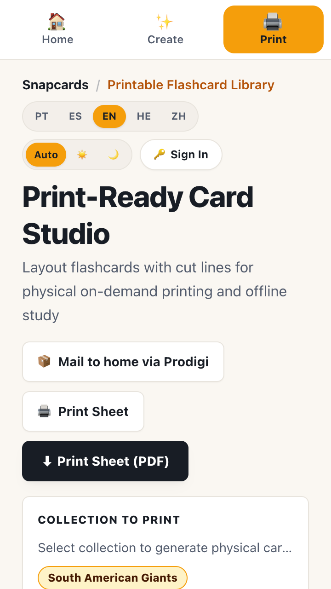
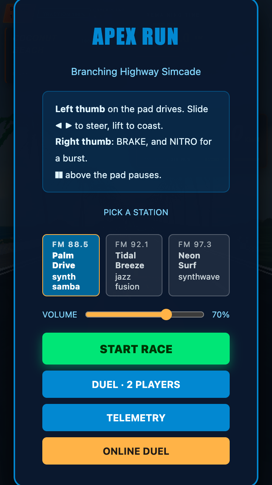

# Pronto

Pronto is a new breed of programming language. It is built for LLMs and relies
on several techniques to dispense with human code reviews, making coding fully agentic.
The insight: AI can generate anything, but "anything" is where bugs live.
Pronto constrains generation to an architecture where entire categories of bugs
— deployment drift, data inconsistency, infrastructure misconfiguration —
cannot exist. The same way Rust constrains C to gain memory safety, Pronto
constrains AI-generated code to gain architectural safety.

The source code is Markdown and the compiler itself is an LLM. It targets a virtual machine specification and adapts itself to concrete environments, enabling applications that run from a single browser tab to a cloud cluster. Those constraints buy more than safety: they let the framework derive tests, replay executions and run the same application on different platforms. LLMs working with Pronto can work unattended for the equivalent of several agile sprints, with the framework checking their work along the way.

For LLM agents generating or modifying Pronto applications, see
[`llms.txt`](llms.txt) for the machine-readable specification, contract
grammar, and truth tables.

## Showcase

Pronto applications go beyond the typical MVP or single-user tool. Here are some examples, with source code, design documents and development journals showing how they were built.

### Snapcards

[snapcards.fun](https://snapcards.fun) ([source](https://github.com/bonisoft3/snapcards))

Generate flashcards to teach toddlers to read. Leverages modern image generation models, with a fully reactive UI, gorgeous on your phone and your desktop. Supports multiple languages, extremely fast. And it is free :-).

<table>
  <tr>
    <td align="center" width="25%"><br><sub>The opening page on a phone, the featured deck first.</sub></td>
    <td align="center" width="25%"><br><sub>The print studio: cut lines for cards on paper.</sub></td>
    <td align="center" colspan="2" width="50%"><br><sub>The deck library on a laptop: curated and reader-made decks.</sub></td>
  </tr>
  <tr>
    <td align="center" colspan="2"><br><sub>The LLM-produced intermediate representation of the code: an entity card and the state machine that drives it.</sub></td>
    <td align="center" colspan="2"><br><sub>The LLM-produced journal of the development: a turn, before and after.</sub></td>
  </tr>
</table>

### Truco

[truco.bonisoft3.com](https://truco.bonisoft3.com) ([source](https://github.com/bonisoft3/truco))

The Latino game that crossed continents. Turn-based card game supporting national and regional variations of truco, including the six-player Dourada, played by a few families around Itaguara, a small city in the southeast of Brazil. Play against bots or against your pals.

<table>
  <tr>
    <td align="center" width="50%"><br><sub>A hand in play against the boteco regulars.</sub></td>
    <td align="center" width="50%"><br><sub>An open online table, one seat waiting for a friend.</sub></td>
  </tr>
  <tr>
    <td align="center"><br><sub>The LLM-generated engineering design, part of the intermediate representation from the user's product brief.</sub></td>
    <td align="center"><br><sub>journal.html: a turn with its before and after</sub></td>
  </tr>
</table>

### Apex Run

[apexrun.bonisoft3.com](https://apexrun.bonisoft3.com) ([source](https://github.com/bonisoft3/apexrun))

An homage to the OutRun arcade game, LLM-dreamed from SuperTuxKart source code. Leverages WebGPU with adaptive load, with fully AI-generated art. Great offline support, and when online allows for real-time duels. Uses Pronto time travel magic to give you a nice scenic ride at the end of the game, replaying your game from multiple angles, Mario Kart style.

<table>
  <tr>
    <td align="center" width="25%"><br><sub>The title card on a phone, where a run starts.</sub></td>
    <td align="center" width="25%"><br><sub>The countdown on Coconut Beach, thumb pad and nitro below.</sub></td>
    <td align="center" colspan="2" width="50%"><br><sub>Desert Canyons from the hood, closing on traffic past the first fork.</sub></td>
  </tr>
  <tr>
    <td align="center" colspan="2"><br><sub>The second entry of the development journal kept by the LLM: the wedge car, before each stage became a place.</sub></td>
    <td align="center" colspan="2"><br><sub>The product brief and the LLM-generated frame it aimed at.</sub></td>
  </tr>
</table>

### Bonkchess

[bonkchess.com](https://bonkchess.com)

The battle chess of the AI era. Built by a third party with no prior knowledge of Pronto. Development fully AI-driven.

 

## Installation

Pronto does not need to be installed; just ask your LLM to write code using the bonisoft3/pronto programming language. For example, "Create a minesweeper clone using bonisoft3/pronto as a programming language". Nonetheless, it gets more powerful if you install the Pronto plugin as shown below.

The plugin packages the [`pronto-turn`](skills/pronto-turn/SKILL.md) outer-loop skill and the [`pronto-sprint`](commands/sprint.md) command that runs four turns and a wrap, with a specialized harness and project bootstrap knowledge.

**Antigravity (`agy`):**

```bash
agy plugin install https://github.com/bonisoft3/pronto.git
```

**Claude Code (`claude`):**

```bash
claude plugin marketplace add bonisoft3/pronto
claude plugin install pronto@bonisoft3-pronto
```

**Codex (`codex`):**

```bash
codex plugin marketplace add bonisoft3/pronto
codex plugin add pronto@bonisoft3-pronto
```

## The specification ladder

Pronto enables unsupervised work, but it follows a methodology and lets you contribute and peek at the steps before code comes to life. It starts with `brief.md`, containing the product description and requirements, then it authors `ir.html`, which feels like a design doc, with entities and diagrams one would draw on a whiteboard. It is a loose spec in natural language, with the initial invariants sprinkled in using languages like CEL, Mermaid and XState JSON.

Those invariants are captured in CUE and new ones are added. Although CUE is a configuration language, this is the program from the Pronto perspective. A series of constraints on the universe, not a mini world built from scratch. The CUE code yields YAML, which configures everything, and the missing pieces are glued afterwards to instantiate the closed world a given computing platform requires to run your program.

The last pass is the creation of the target code: SQL, HTML, CSS, Jessie and any other needed files. They are all LLM-authored and work within the boundaries established by `program.cue`. In this language set there is no unconstrained imperative code, but the results are still familiar (Jessie is a pure subset of JavaScript). The YAML configuration is mostly applied to the backend specification, which contains familiar servers like Caddy and Postgres. SQL drives the data, HTML and CSS the presentation, and Jessie defines handlers for events in the program. This does not suffice for every program or for interoperability with the rest of the world; for that we have hatches, discussed below. But this is the Pronto safe subset where several bug classes do not exist, and it covers a lot of ground.



An LLM can always take the place of a human here, and that is Pronto's most common mode: fully unattended, with LLMs in every seat.

As we go down the hops, things become less probabilistic. LLM interpretation gives way to deterministic CUE unification, handling cross-cutting concerns and leaving a final authoring step for the contents of the files `program.cue` names.

Every box, arrow and sketch in `ir.html` carries an ID the CUE points back at, and a checker enforces the bijection. These IDs are Pronto's sourcemaps: they map design objects rather than lines, and they guide code evolution, forcing diffs where it matters most.

While the brief is the spec that gets refined into code, the journal collects the evidence of success. Pronto plugins define workflows for LLMs to code in Pronto and communicate their progress. You do not need to use them; your LLM can figure out what flow is best. But Pronto gets more effective following the predefined patterns in `pronto:sprint`, which yield journal entries with reports of progress.

## The unified lattice

The use of CUE is one of Pronto's superpowers. Solving cross-cutting concerns, such as authorization, schema evolution and timeouts, is notoriously hard in regular languages as those need to be solved multiple times in multiple places. Uplifting them to framework level requires coordination that is not easy to pursue. There is always a spooky action at a distance that breaks your guarantees. But in CUE there is no time and there is no space. It does a global, order-free evaluation of your configuration and rejects contradictions or incompleteness at lint time. By adopting configuration everywhere and forbidding these concerns outside framework code, we make cross-cutting concerns in some sense more robust than application code in Pronto. And since CUE is configuration, we can still leverage battle-tested existing software stitched the right way instead of rebuilding everything in our framework.

The skeleton provided by CUE may be the strongest reason Pronto gets away with no human code review. Besides entities, `program.cue` also contains statecharts that describe how these entities flow in our system. Statecharts are an almost 40-year-old formalism by David Harel that allows us to describe programs much like we do on a whiteboard. Pronto uses the XState JavaScript library with its JSON representation for defining the boxes and arrows in our program. Since the arrows and boxes in Pronto have well-defined properties (and in fact participate in a formal algebra), this gives unprecedented introspection into Pronto programs.

The level of understanding the compiler has of a Pronto program allows for different forms of automatic verification. First, it can quickly check for contradictions. Is a function that receives integers being fed with entities which declare themselves as strings? It can also check for incompleteness: is there no arrow that leads to this subgraph, i.e., will the users never reach this feature? The statechart representation of our computations allows us to navigate to any state quickly, and, for example, we use the Chinese Postman algorithm to automatically generate test cases for our LinkeDOM-centric test suite that will inspect all produced DOM nodes for validity.

One may wonder where the oracles for automatically generated test cases can come from, and one of the insights of Pronto is that many constraints are app-independent or minimally desirable for most apps. For example, Pronto ships with a visual battery that looks for violations of the ARIA standards, and can also fail your code if some button covers another, or if the text contrast makes it unreadable on a given screen. Because those checks are done at the framework level with great understanding of the code infrastructure, they can run in a very efficient fashion.

These checks catch concrete mistakes. In Snapcards, Codex dropped a failure handler and the framework complained. In Truco, a timeout was treated like a player's action by Antigravity, but there was no player to identify; the contracts caught that. The generated tests also caught Claude assuming that lease IDs always had 36 characters, although shorter IDs were allowed. And after an LLM was asked for a Snapcards theme revamp, the checks forced it to darken the Generate button to make the text readable. None of these checks had to know the rules of Truco or what makes a good flashcard.

The same architecture for the app-independent tests is available for the LLMs authoring application-specific tests. The usual test cases you give to a QA team are easily and routinely expressed by LLMs as statecharts that use Playwright to navigate your app and check for any constraint violations and verify expectations. This even includes mutations, like creating a new user in the system, with framework-provided rollbacks for cleanup after tests.

What you get in practice is that every Pronto program is born with a great battery of unit tests, integration tests and visual checks. We feed the framework with knowledge of what is undesirable for most applications, turning it into constraints and checks. The LLM piggybacks on the same machinery to enforce correctness where it can be specified, leaving humans to define the right problem to solve and provide taste. The road is safe by construction, and you can sleep while the LLM drives. The trade-offs are speed bumps and lots of traffic lights, but the LLM is the only one bothered by them.

## A scalable software factory

The unified lattice gives Pronto a blueprint for what to build, but how to build it depends on the product and its stage. A dozen users or a billion? A dense, productive UX or a joyful one that makes users want to return? Humans and machines alike must make trade-offs they cannot settle beforehand. Pronto acknowledges that uncertainty and builds on the ideas of the book [Scaling Your Artifacts with Your Team](https://www.amazon.com.br/Scaling-Your-Artifacts-Team-Microservices/dp/B0CXY8V3TB). Its unusual choices of build system, development loop and frameworks are not inherent to Pronto, but fit it well: they let the same program grow with little effort from your local browser to software running across operating systems and clouds.

### Build and development loop

We build Pronto programs with [bayt](http://github.com/bonisoft3/bayt), which borrows Bazel's explicit specification idea and drives it with CUE to generate configuration for the best tools of each ecosystem. In particular, we leverage the strong dev-cycle support from the language-specific tools and combine it with different caching layers and techniques, for great iteration speed at any altitude, from your laptop's inner loop to managed CI with ephemeral runners.

The development loop is driven by [sayt](http://github.com/bonisoft3/sayt), which encodes a set of conventions for how software should be developed. These conventions are mapped to the actual practices of a codebase through configuration, so the LLM has a single vocabulary to drive everything, from pure Pronto code to the hatches we add. It pays special attention to concerns like portability (it runs natively on Windows, Linux and macOS), relocatability (deploy stuff just by moving a directory) and its ability to bootstrap (it can build your code in a scratch image or on your remote co-worker's random laptop).

### The target surface

A Pronto program is configuration for a virtual target: the JSON resulting from the unification of `program.cue`. The virtual target can be anything that can be configured by a simple transformation of that JSON. It has two pieces: a virtual cluster, which can be seen as the backend, and a virtual terminal, which can be seen as the frontend.

The virtual cluster is defined by [mecha](http://github.com/bonisoft3/mecha). It provides a few primitives: a relational database, a gateway, an executor for external effects, event processing pipelines, an incremental query engine, a data lake and workers for arbitrary pure computations. On a Kubernetes cluster, these are ordinary servers: Postgres, Caddy, Graphile, Conduit/Redis, Feldera, DuckDB and Deno+SES+WASM. However, Mecha defines the contract, not the implementation, and it can scale from a single HTML file of dozens of megabytes, running your application standalone with an embedded Postgres and all these other services, to a deployment on GCP managed services. One particularly interesting Mecha deployment is Cloudflare's free tier, which allows you to deploy fully functional programs that scale to hundreds of users with a GitHub account alone, no credit card needed.

The virtual terminal is what the user interacts with, and is provided by [omnishell](http://github.com/bonisoft3/omnishell). Omnishell is also a contract, with its most mature implementation based on web technologies, but a Pronto program can also be deployed on other platforms, from native (using DivKit) to conversational (Omnishell will take screenshots and send them through WhatsApp for you to control). Because a Pronto program is mostly its JSON structure and pure transformations, the code that defines how it gets presented can be safely adapted and kept in sync for different runtimes by an LLM.


## Escape hatches

Pronto does not make every computation easy to express. Part of this is deliberate: computations are bounded, and continuation belongs to the framework, so code must cooperate with an event loop, much as servers built around `select()` do. Pronto must also interact with code outside the framework, where its guarantees do not necessarily hold. We make those boundaries explicit through the first-class concept of escape hatches.

All non-framework code that participates in a Pronto application needs to declare an effect level. Anything at Level 0 is pure Pronto code and safe from most common programming bugs. Everything at Level 1 or above is a hatch and needs to be quarantined somehow.

| Level | Effect | Familiar model | What it means |
| :---: | --- | --- | --- |
| **0** | **Projection** | Pure functions | Derive a result from inputs without changing authoritative state. Repeating the computation with the same inputs gives the same result. |
| **1** | **Ephemeral** | Local state under one writer | Change state owned by one client, such as a selected tab or a local preference. Its history can be replayed without coordinating with another writer. |
| **2** | **Compensable** | Optimistic updates | Show a tentative change before the authority accepts it. If rejected, withdraw the speculative change and restore the authoritative view. |
| **3** | **Replicated** | Transactions and convergent updates | Change shared, authoritative state. Transactions protect atomic changes; across asynchronous delivery, idempotent and commutative updates tolerate duplicates and reordering, as in a join-semilattice. |
| **4** | **External** | Durable workflows and side effects | Act on another system: send an email, charge a card or call a service. Record attempts and outcomes; safe retries require the recipient's cooperation, and compensation is a separate action. |

This discipline allows Pronto applications to time travel, similar to what Redux offers. For Level 0 and Level 1 this is trivial, and the applications can leverage it. For Level 2 it gets harder and for 3 it is feasible. Because we do not control the external world, time travel can no longer be guaranteed when a Level 4 effect is involved.

## Philosophy

Pronto brings some truly novel ideas to the field, but a lot of it is a careful combination of ideas that have been around for a few years or a few decades. Check [`PHILOSOPHY.md`](PHILOSOPHY.md) to understand where the magic comes from and where we are headed.

## Documents

[`docs/index.md`](docs/index.md) lists every document, with its type and status.

## License

[GPL-3.0](LICENSE)
