# Pronto

Pronto is a new breed of programming language. It is built for LLMs and relies
on several techniques to dispense code reviews, making coding fully agentic. 
The insight: AI can generate anything, but "anything" is where bugs live.
Pronto constrains generation to an architecture where entire categories of bugs
— deployment drift, data inconsistency, infrastructure misconfiguration —
cannot exist. The same way Rust constrains C to gain memory safety, Pronto
constrains AI-generated code to gain architectural safety.

The source code is markdown and the compiler itself is an LLM. It targets a virtual machine specification and adapts itself to concrete environments, enabling applications that run identically from a single browser tab to a cloud cluster. Pronto needs no supervision and no humans ever look at the code it generates. It runs unattended for the equivalent of several agile sprints and ships world-class software.

For LLM agents generating or modifying Pronto applications, see
[`llms.txt`](llms.txt) for the machine-readable specification, contract
grammar, and truth tables.

## Showcase

Pronto creates production-grade applications that scale in many dimensions. It
goes well beyond the typical the MVP with a single user. Here are some example
apps. No human has ever looked at their source code during development.

### Snapcards

[snapcards.bonisoft3.com](https://snapcards.bonisoft3.com) ([source](https://github.com/bonisoft3/snapcards))

Generate flashcards to teach toddlers to read. Leverages modern image generations models, fully reactive UI, gorgeous in your phone and your desktop. Supports multiple languages, extremelly fast. And it is free :-).

<table>
  <tr>
    <td align="center" rowspan="2" width="22%">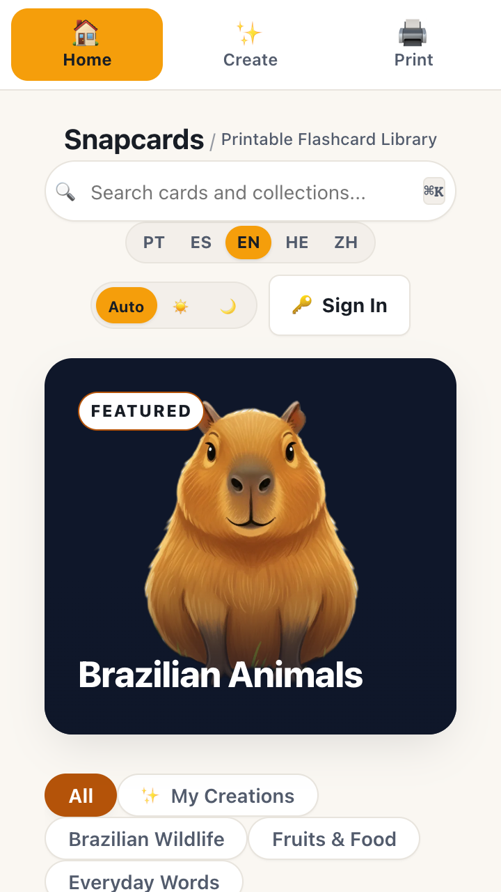<br><sub>The opening page on a phone, the featured deck first.</sub></td>
    <td align="center" width="39%">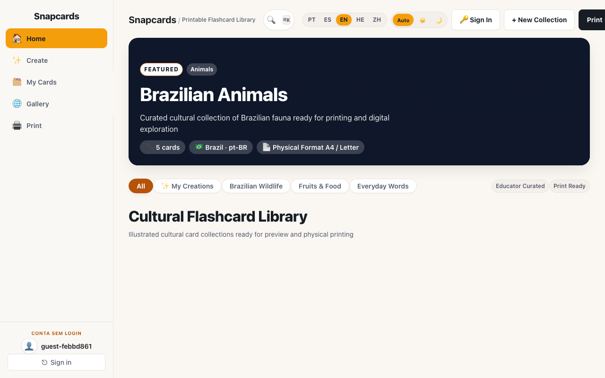<br><sub>The deck library on a laptop: curated and reader-made decks.</sub></td>
    <td align="center" width="39%">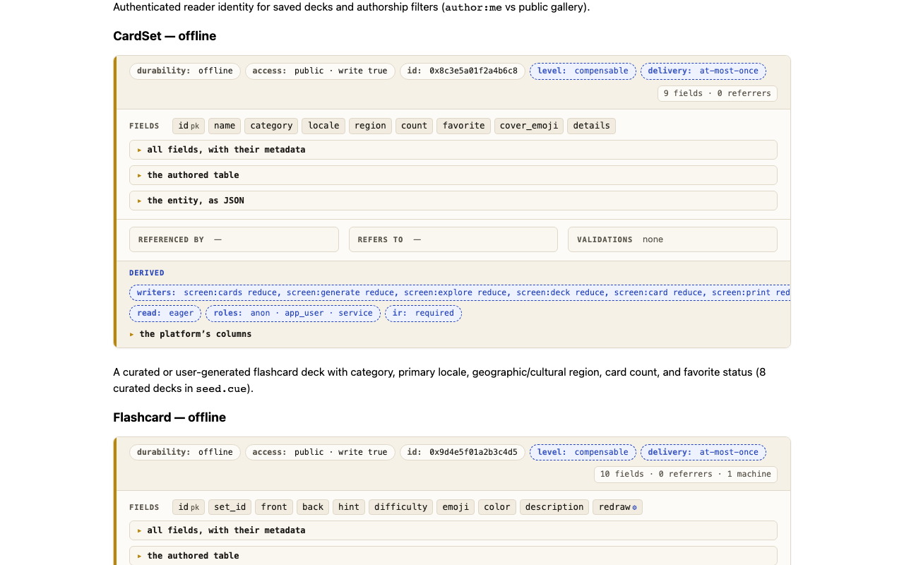<br><sub>The LLM-produced intermediate representation of the code: an entity card and the state machine that drives it.</sub></td>
  </tr>
  <tr>
    <td align="center" colspan="2">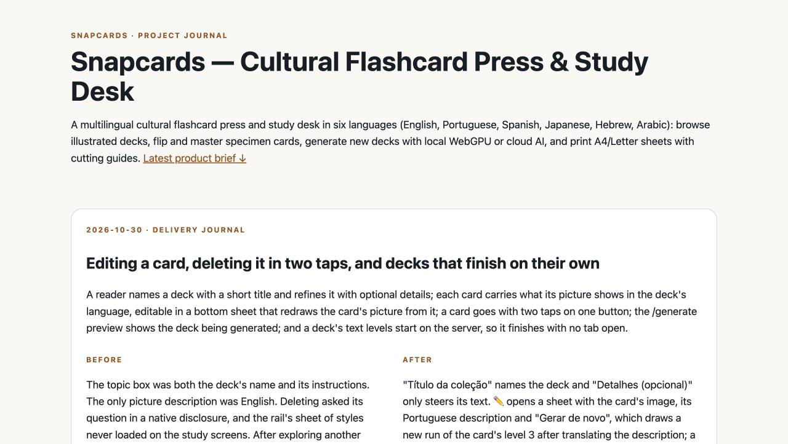<br><sub>The LLM-produced journal of the development: a turn, before and after.</sub></td>
  </tr>
</table>

### Truco

[truco.bonisoft3.com](https://truco.bonisoft3.com) ([source](https://github.com/bonisoft3/truco))

The latino game that crossed continents. Turn based card game supporting country and regional variations of truco, including the six players Dourada, played a few families in the Itaguara region, a small city in the southeast of Brazil. Play against bots or against your pals. 

<table>
  <tr>
    <td align="center" width="50%">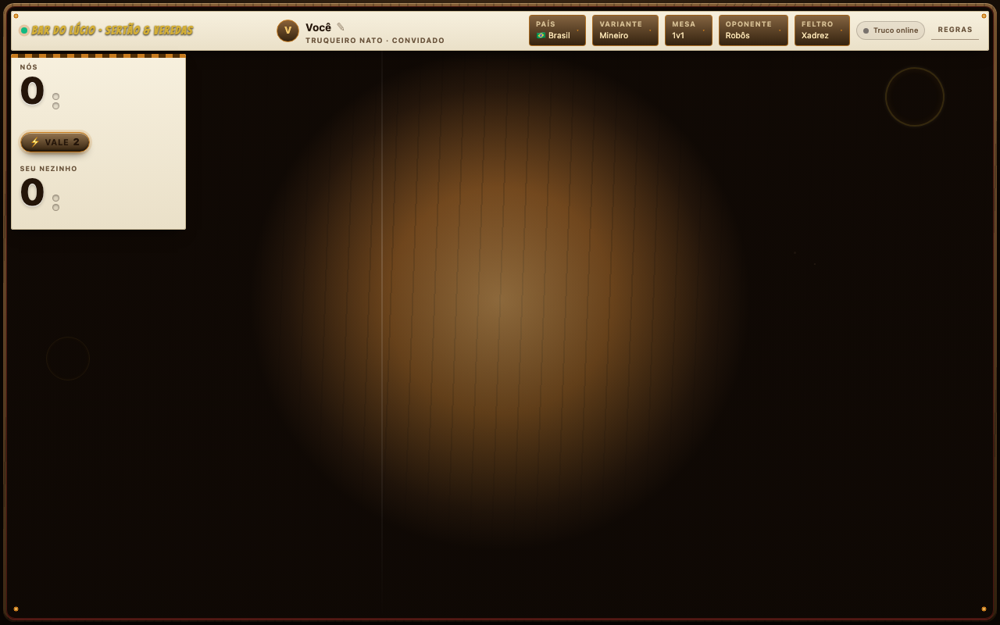<br><sub>A hand in play against the boteco regulars.</sub></td>
    <td align="center" width="50%">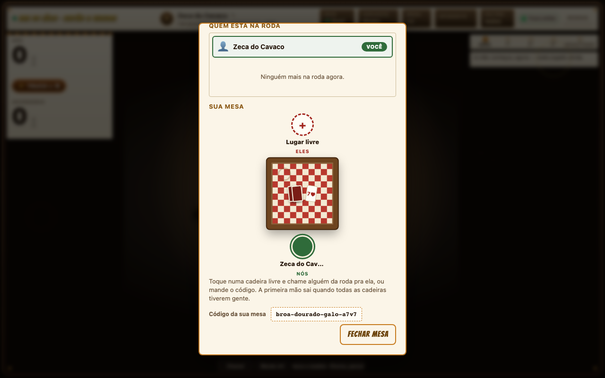<br><sub>An open online table, one seat waiting for a friend.</sub></td>
  </tr>
  <tr>
    <td align="center">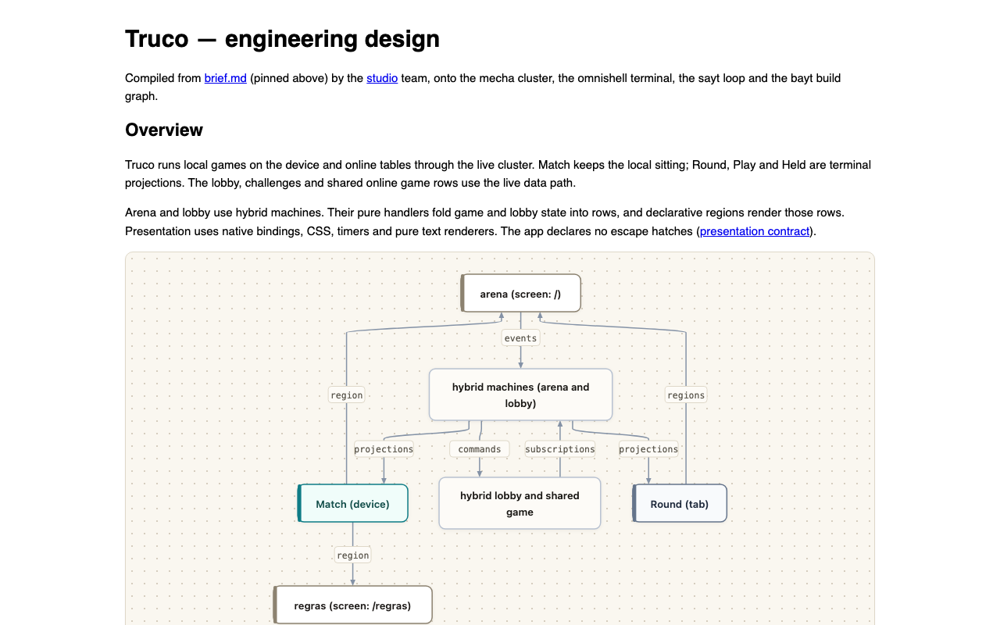<br><sub>The llm-generated engineering design, part of intermediate representation from the user product brief.</sub></td>
    <td align="center">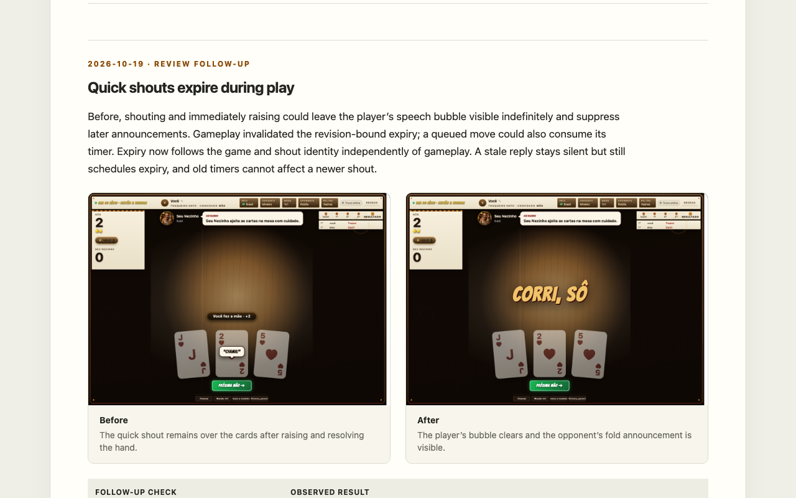<br><sub>journal.html: a turn with its before and after</sub></td>
  </tr>
</table>

### Apex Run

[apexrun.bonisoft3.com](https://apexrun.bonisoft3.com) ([source](https://github.com/bonisoft3/apexrun))

A homage to the OutRun arcade game, llm-dreamed from super tux kart source code. Leverages webgpu with adaptive load, art fully AI generated. Great offline support, and when online allows for realtime duels. Uses pronto time travel magic to give you a nice scenic ride on game end, replaying your game from multiple angles, Mario Kart style.

<table>
  <tr>
    <td align="center" width="50%">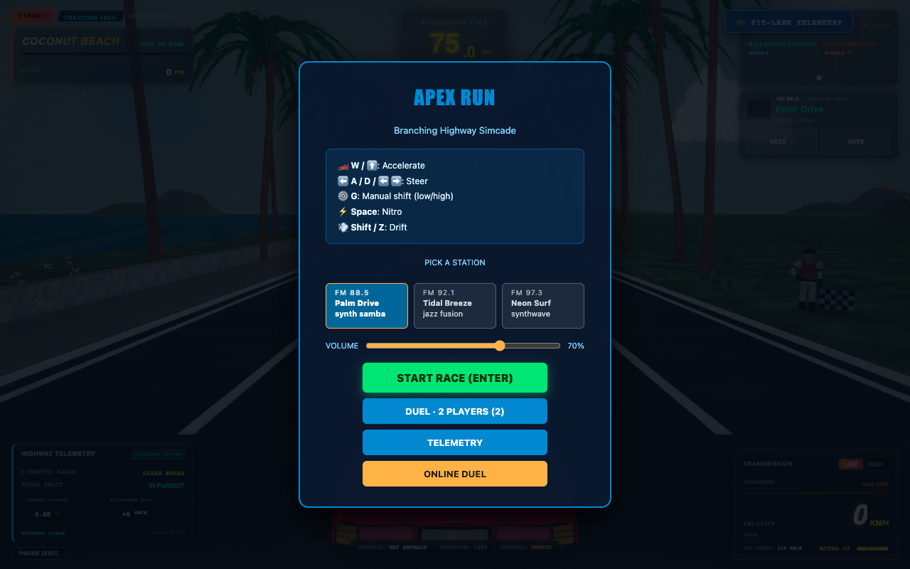<br><sub>The title card, where a run starts.</sub></td>
    <td align="center" width="50%"><br><sub>The highway at 60 Hz, nitro and traffic.</sub></td>
  </tr>
  <tr>
    <td align="center">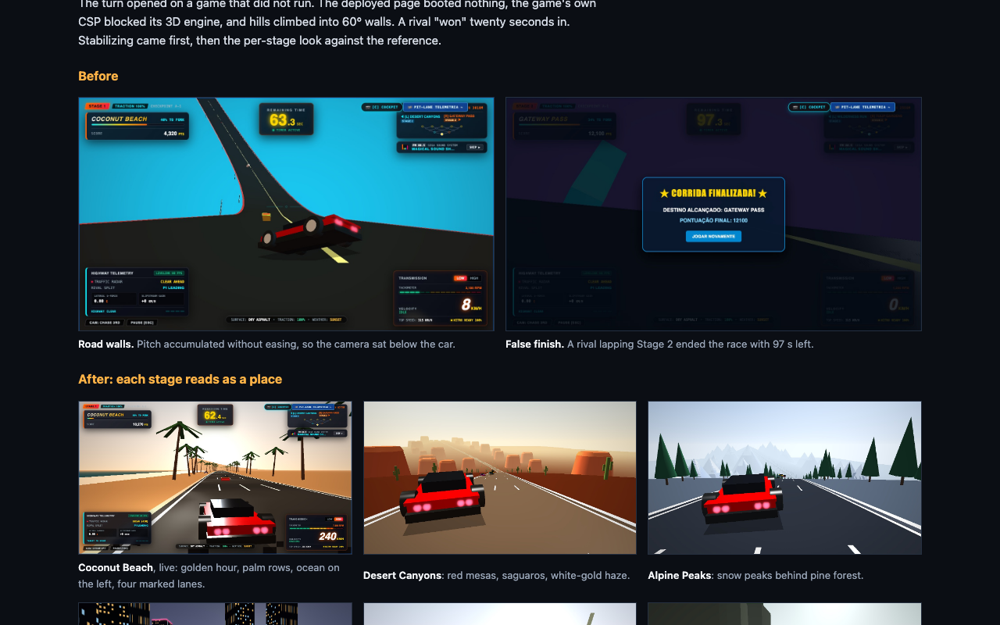<br><sub>The second entry of the development journal kept by the LLM: the wedge car, before each stage became a place.</sub></td>
    <td align="center">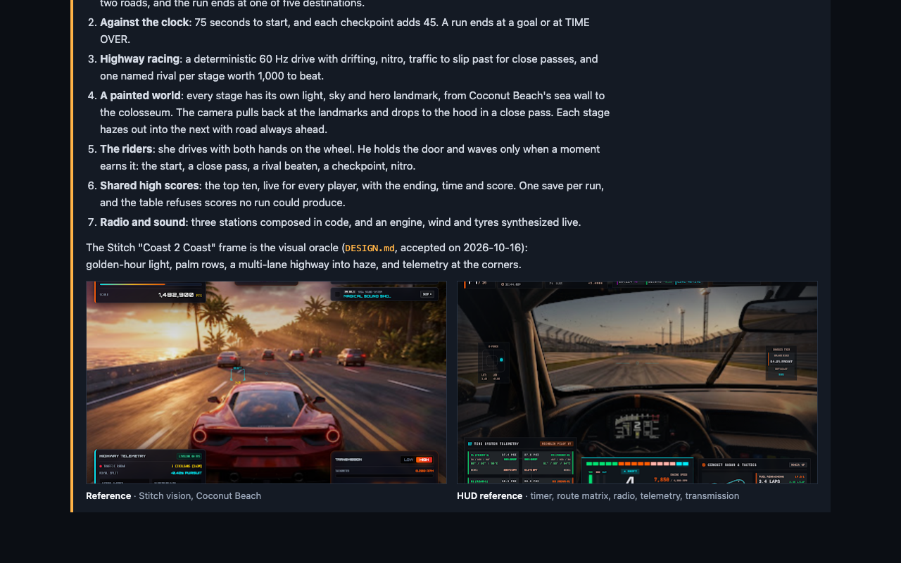<br><sub>The product brief and the llm-generated frame it aimed at.</sub></td>
  </tr>
</table>

### Bonkchess

[bonkchess.com](https://bonkchess.com)

The battle chess of the AI era. Built by a third party with no prior knowledge of pronto. Development fully ai-driven.

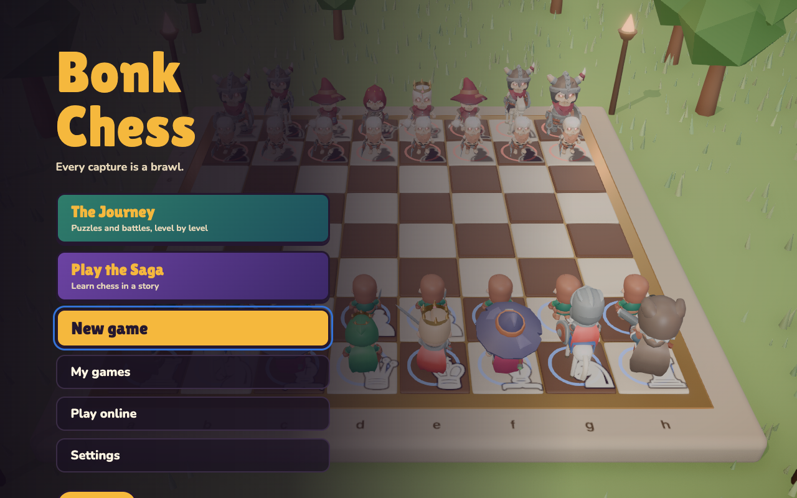 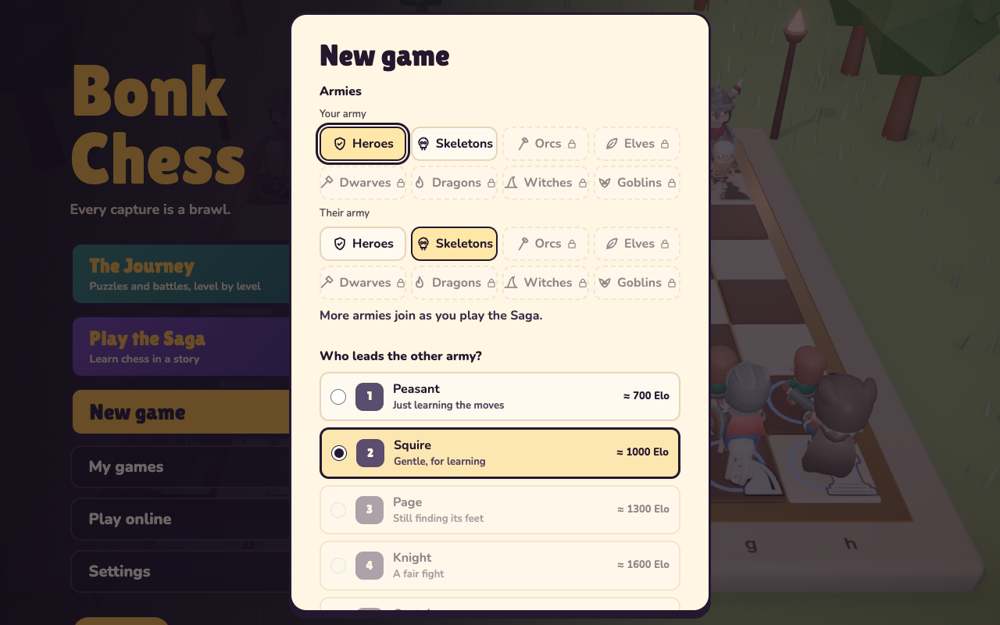


## Installation

Pronto does not need to be installed, just ask your LLM to write code using the bonisoft3/pronto programming language. For example, "Create a minesweeper clone using bonisoft3/pronto as a programming language". Nonetheless, it gets more powerful if you install the pronto plugin as shown below.

The plugin packages the [`pronto-turn`](skills/pronto-turn/SKILL.md) outer-loop skill and the [`pronto-sprint`](commands/sprint.md) command that runs four turns and a wrap, with a specialized harness and project bootstrap knowledge.

**Antigravity (`agy`):**
```bash
agy plugin install https://github.com/bonisoft3/pronto.git
```

**Claude Code (`claude`):**
```bash
claude plugin marketplace add bonisoft3/pronto
claude plugin install pronto@bonisoft3-pronto
```

**Codex (`codex`):**
```bash
codex plugin marketplace add bonisoft3/pronto
codex plugin add pronto@bonisoft3-pronto
```

## The specification ladder

Pronto needs no human code review, but it follows a methodology and let you contribute and peek on the steps that happen before code comes into life. It starts with the brief.md, containing the product description and requirements, then it authors ir.html, which feels like a design doc, with entities and the diagrams one would drawn in a whiteboard. It is a loose spec in natural language, with the initial invariants sprinkled in, with languages like CEL, mermaid and xstate json.

Those invariants are captured in cuelang and new ones are added. Although cuelang is a configuration language, this is the program from the Pronto perspective. A series of constraints on the universe, not a mini world built from the scratch. The cue code yields yaml, which configures everything, and the missing pieces are glued afterwards to instantiate the closed world a given computing platform requires to run your program.

The last pass is the creation of the target code, sql, html, css, and jessie files, and any other needed files. They are all llm authored and work on the boundaries of program.cue. In this language set there is not imperative unconstrained code, but the results are still familiar (jessie is a pure subset of javascript). The yaml configuration is mostly applied to the backend specification which contains a collection of familiar servers, like caddy and postgres, sql drives the data, html and css the presentation, and jessie defines handlers for data transformation as it moves around. This does not suffice for every program or for interoperability with the rest of the world, and for that we have hatches discussed below. But this is the pronto safe subset where several bug classes do not exist and it covers a lot of ground.

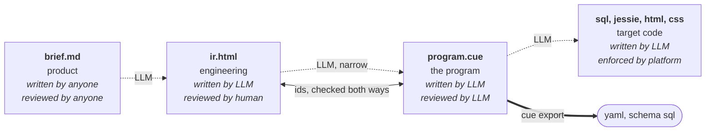

An LLM can always take the place of a human here, and that is pronto's most common mode: fully unattended, with LLMs in every seat.

As we go down the hops, things become less probabilistic. From fully free form brief.md, we go to fully free content in a specific format for ir.html, and to get to program.cue we interpret ir.html as a loose spec with strict invariants sprinkled in. From program.cue to final application form we are doing deterministic cue unification, handling cross cutting concerns, and leaving a final authoring step for the contents of the files program.cue names. 

Every box, arrow and sketch in `ir.html` carries an id the CUE points back at, and a checker enforces the bijection. These ids are pronto's sourcemaps: they map design objects rather than lines, and they guide code evolution forcing diffs where it matters most.

While the brief is the spec that gets refined into code, the journal collects the evidence of success. Pronto plugins define workflows for the LLMs to code in pronto and communicate its progress. You do not need to use it, your LLM can figure out what flow is best, and the platform will prevent it from writing buggy code. But pronto get more effective following the pre-defined patterns in pronto:sprint, which will yield the journal entries with reports of progress.

## The target surface

The compiled program is data, not code. `cue export` emits:

- **YAML configs** for mecha — schema DDL, PostgREST routes, CDC pipeline definitions (bloblang/jq), ElectricSQL shapes
- **Omnishell config** — layout, routes, auth, forms; the shell interprets it at runtime, there is no build step
- **HTML/CSS** for the screens
- **JS handlers** for the residue of state handling that config cannot express

### JS handlers

Omnishell's doctrine — single data path, forms-only mutations, reactive live queries — already removes effects, fetching, and imperative DOM from application code. What remains is pure derivation and event handling, and it is confined in layers:

1. **CUE absorbs pure derivations.** Computed fields, filters, and validation live in the program itself. CUE is total: every expression terminates.
2. **Remaining handlers are authored in [Jessie](https://github.com/endojs/Jessie)** — the defined safe subset of JavaScript (strict functional core; no `this`, no classes, no ambient authority). Still JS syntax, so LLM fluency is untouched.
3. **Enforced twice**: statically by a gate on the names Jessie denies at compile time, dynamically by running each handler inside an SES Compartment (the mechanism behind MetaMask Snaps).
4. **Deterministic by construction**: time and randomness arrive as inputs injected by the runtime, never ambient — the same discipline Temporal enforces on workflow code.

Net property: nothing in a Pronto application runs with ambient authority. For fixed-step simulation time travel, see [kinetic.md](https://github.com/bonisoft3/omnishell/blob/v0.21.6/docs/kinetic.md).

## Escape hatches

Pronto cannot express every computation. Four escapes, ranked; all appear as boxes in ir.html so every hole in the guarantees is visible in the design doc:

| Escape | Guarantee | Runs where |
|--------|-----------|-----------|
| **Pre-compiled WASM** (preferred) | Sandboxed; touches Pronto state only through its CUE-contracted interface | Every tier — the same `.wasm` runs in the tab, in CDC pipelines, and server-side |
| **Vendored unit** (terminal-tier hatch) | Trusted, audited component or worker mounted by the terminal at a declared point; CUE-contracted props-in/events-out with declared isolation (compartment, realm, or agent) and ports (the entities it reads, the events it raises) | Browser surface, every tier |
| **Container** | Full escape | Real container at the container and cloud tiers; at the browser tier it binds to a **declared shim** (mock or degraded WASM stand-in), consistent with mecha's best-effort browser consistency model |
| **External API endpoint** | Clean trust boundary: the Pronto database is only touched by Pronto; beyond HTTP is the external world | Every tier |

The browser-tier shim supplies an in-browser implementation behind the same interface. Declaring the shim forces the interface contract to be precise enough to mock — pressure in the right direction. (Live-in-tab containers via container2wasm/v86 exist as an opt-in, at emulation speed; WebContainers-class products require commercial licenses.)

### The loop

Development turns **the loop** — the lifecycle contract (the ten verbs, the
TDD cascade, CI), default implementation [sayt](https://github.com/bonisoft3/sayt) (`sayt:loop`,
rostered as `pronto/loops:sayt`) — and the loop drives **the build graph**,
default [bayt](https://github.com/bonisoft3/bayt) (rostered as `pronto/builders:bayt`, handed the
program's build seat as concrete `bayt.json`). Programs target a cluster,
users touch a terminal, developers turn the loop; all four seats are
published CUE, overridable by unification, versioned and forked by module
pin.

 It targets
[omnishell](https://github.com/bonisoft3/omnishell) for UI,
[mecha](https://github.com/bonisoft3/mecha) for the backend,
[bayt](https://github.com/bonisoft3/bayt) for build, and
[sayt](https://github.com/bonisoft3/sayt) for the SDLC — producing applications
that run identically from a single browser tab to a cloud cluster.


### The virtual terminal

The frontend is the cluster's **virtual terminal**. As in the block-mode terminals of mainframe lineage, a screen is rendered from data and the only way back is submitting a form — but this terminal carries its own replica of its slice of the cluster: reads are local and reactive, writes land locally first and travel the same CDC guarantees, so offline is the default condition rather than an error state. What remains of client computation is Elm-shaped — pure `(state, event) → state'` handlers, effects owned entirely by the shell. A 3270 with a database in its pocket, attached to a cluster that can live in the same tab.

### The unified lattice

Pronto does not coordinate cross-cutting concerns (durabilities, effect safety spectrum, RLS authorization, offline queueing, and test fuel budgets) through procedural pipelines or middleware stacks. Instead, every concern is an orthogonal dimension of a **bounded join-semilattice**. CUE unification (`&`) is the mathematical Greatest Lower Bound ($\sqcap$): database schema, interaction lifecycles, and verification tiers intersect into a single deterministic fixed point. Most contradictions fail closed at compile time (`cue vet`) before code runs; [the lattice](docs/lattice.md#which-joins-the-code-enforces) lists the joins checked later, at lint or when the writer runs, and those not checked yet.

## Philosophy

Pronto brings some truly novel ideas to the field, but a lot of it is a careful combination of ideas that have been around for a few years or a few decades. Check [`PHILOSOPHY.md`](PHILOSOPHY.md) to understand where the magic comes from and where we are headed.

## License

[GPL-3.0](LICENSE)
