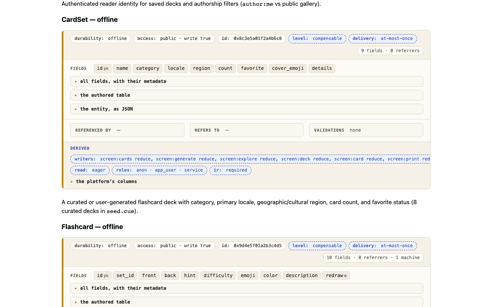
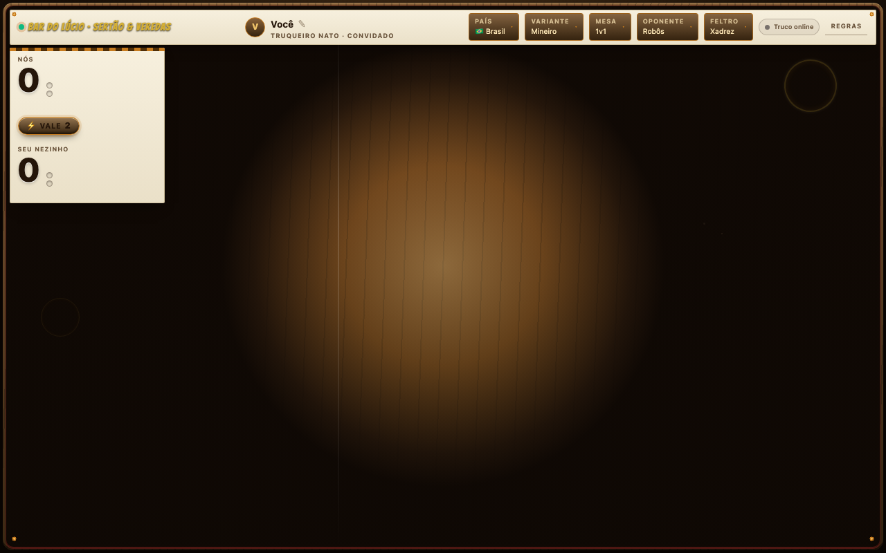
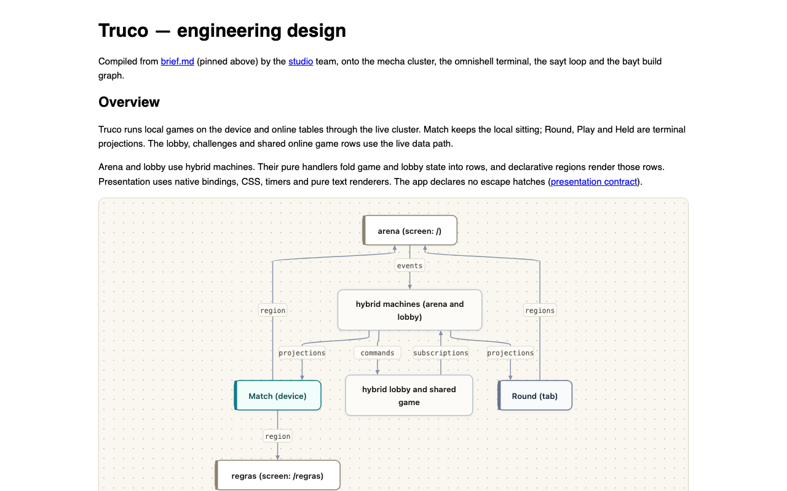
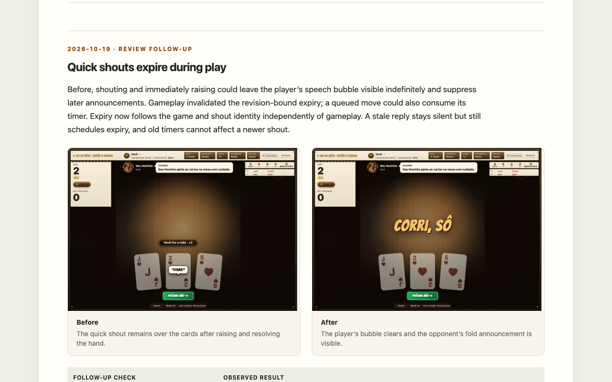
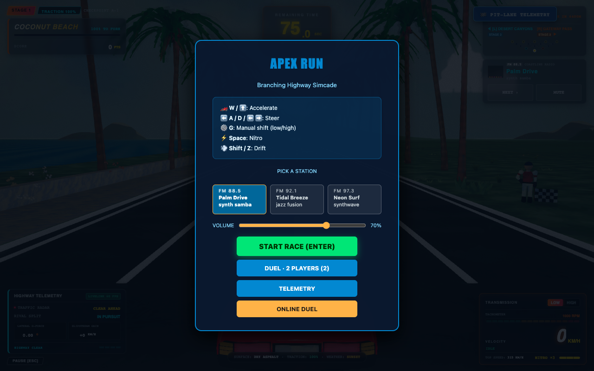
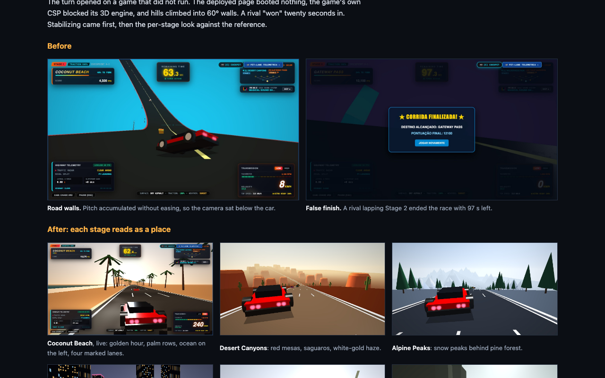
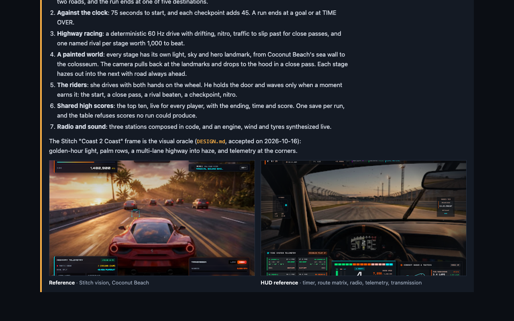
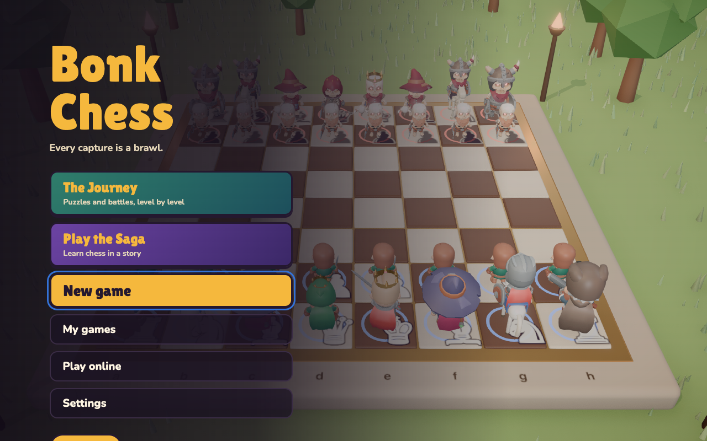
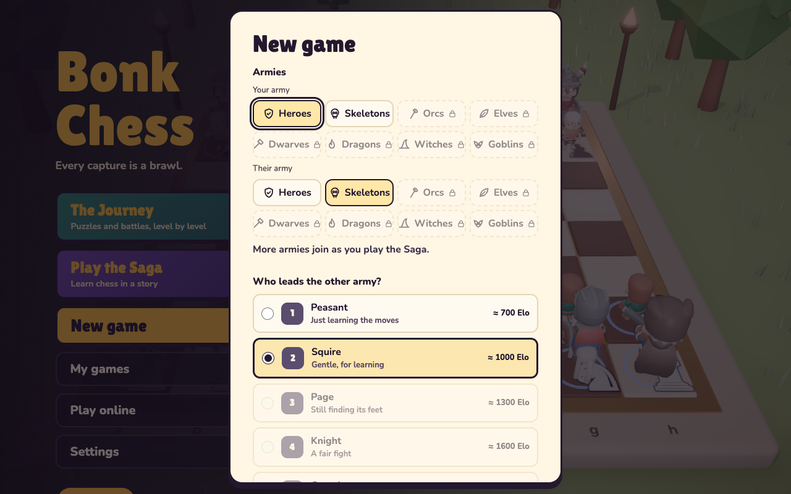
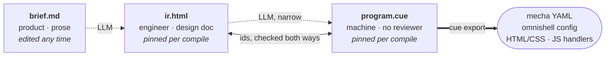

# Pronto

Pronto is a new breed of programming language. It is built for LLMs and relies
on different techniques to dispense code reviews, making coding fully agentic. 
The insight: AI can generate anything, but "anything" is where bugs live.
Pronto constrains generation to an architecture where entire categories of bugs
— deployment drift, data inconsistency, infrastructure misconfiguration —
cannot exist. The same way Rust constrains C to gain memory safety, Pronto
constrains AI-generated code to gain architectural safety.

The source code is markdown and the compiler itself is an LLM. It targets
[omnishell](https://github.com/bonisoft3/omnishell) for UI,
[mecha](https://github.com/bonisoft3/mecha) for the backend,
[bayt](https://github.com/bonisoft3/bayt) for build, and
[sayt](https://github.com/bonisoft3/sayt) for the SDLC — producing applications
that run identically from a single browser tab to a cloud cluster.

Pronto needs no supervision and no humans ever look at the code it generates. It runs unattended
for the equivalent of several agile sprints and ships world-class software.

For LLM agents generating or modifying Pronto applications, see
[`llms.txt`](llms.txt) for the machine-readable specification, contract
grammar, and truth tables.

## Showcase

Pronto creates production-grade applications that scale in many dimensions. It
goes well beyond the typical the MVP with a single user. Here are some example
apps. No human has ever looked at their source code during development.

### Snapcards

[snapcards.bonisoft3.com](https://snapcards.bonisoft3.com) ([source](https://github.com/bonisoft3/snapcards))

Generate flashcards to teach toddlers to read. Leverages modern image generations models, fully reactive UI, gorgeous in your phone and your desktop. Supports multiple languages, extremelly fast. And it is free :-).

<table>
  <tr>
    <td align="center" rowspan="2" width="22%"><br><sub>The opening page on a phone, the featured deck first.</sub></td>
    <td align="center" width="39%"><br><sub>The deck library on a laptop: curated and reader-made decks.</sub></td>
    <td align="center" width="39%"><br><sub>The LLM-produced intermediate representation of the code: an entity card and the state machine that drives it.</sub></td>
  </tr>
  <tr>
    <td align="center" colspan="2"><br><sub>The LLM-produced journal of the development: a turn, before and after.</sub></td>
  </tr>
</table>

### Truco

[truco.bonisoft3.com](https://truco.bonisoft3.com) ([source](https://github.com/bonisoft3/truco))

The latino game that crossed continents. Turn based card game supporting country and regional variations of truco, including the six players Dourada, played a few families in the Itaguara region, a small city in the southeast of Brazil. Play against bots or against your pals. 

<table>
  <tr>
    <td align="center" width="50%"><br><sub>A hand in play against the boteco regulars.</sub></td>
    <td align="center" width="50%"><br><sub>An open online table, one seat waiting for a friend.</sub></td>
  </tr>
  <tr>
    <td align="center"><br><sub>The llm-generated engineering design, part of intermediate representation from the user product brief.</sub></td>
    <td align="center"><br><sub>journal.html: a turn with its before and after</sub></td>
  </tr>
</table>

### Apex Run

[apexrun.bonisoft3.com](https://apexrun.bonisoft3.com) ([source](https://github.com/bonisoft3/apexrun))

A homage to the OutRun arcade game, llm-dreamed from super tux kart source code. Leverages webgpu with adaptive load, art fully AI generated. Great offline support, and when online allows for realtime duels. Uses pronto time travel magic to give you a nice scenic ride on game end, replaying your game from multiple angles, Mario Kart style.

<table>
  <tr>
    <td align="center" width="50%"><br><sub>The title card, where a run starts.</sub></td>
    <td align="center" width="50%"><br><sub>The highway at 60 Hz, nitro and traffic.</sub></td>
  </tr>
  <tr>
    <td align="center"><br><sub>The second entry of the development journal kept by the LLM: the wedge car, before each stage became a place.</sub></td>
    <td align="center"><br><sub>The product brief and the llm-generated frame it aimed at.</sub></td>
  </tr>
</table>

### Bonkchess

[bonkchess.com](https://bonkchess.com)

The battle chess of the AI era. Built by a third party with no prior knowledge of pronto. Development fully ai-driven.

 


## Installation

Pronto does not need to be installed, just ask your LLM to write code using the bonisoft3/pronto programming language. For example, "Create a minesweeper clone using bonisoft3/pronto as a programming language". Nonetheless, it gets more powerful if you install the pronto plugin as shown below.

The plugin packages the [`pronto-turn`](skills/pronto-turn/SKILL.md) outer-loop skill and the [`pronto-sprint`](commands/sprint.md) command that runs four turns and a wrap, with a specialized harness and project bootstrap knowledge.

**Antigravity (`agy`):**
```bash
agy plugin install https://github.com/bonisoft3/pronto.git
```

**Claude Code (`claude`):**
```bash
claude plugin marketplace add bonisoft3/pronto
claude plugin install pronto@bonisoft3-pronto
```

**Codex (`codex`):**
```bash
codex plugin marketplace add bonisoft3/pronto
codex plugin add pronto@bonisoft3-pronto
```

## The specification ladder

Pronto needs no human code review, but it lets people review what exists before code. It writes three artifacts, one per audience; each reviews at its own rung and nobody reviews below it.



Only the dotted hops are probabilistic, and the second is narrow: the structured parts of `ir.html` (entities, flows, data paths) extract into CUE deterministically. Every box, arrow and sketch in `ir.html` carries an id the CUE points back at, and a checker enforces the bijection. These ids are pronto's sourcemaps: they map design objects rather than lines, survive into the running DOM as `data-*` attributes, and are checked rather than trusted.

The brief is the spec, the journal the evidence. `brief.md` says what the app is and what the next sprint delivers; people edit it any time, a turn never does. `journal.html` holds each turn's before/after screenshots, recordings and gate output, newest first, and carries no requirements. A sprint is four turns and a wrap that rewrites the brief and prunes the journal; git keeps the rest, and the tree, not either document, is the state a turn resumes from.

## The target surface

The compiled program is data, not code. `cue export` emits:

- **YAML configs** for mecha — schema DDL, PostgREST routes, CDC pipeline definitions (bloblang/jq), ElectricSQL shapes
- **Omnishell config** — layout, routes, auth, forms; the shell interprets it at runtime, there is no build step
- **HTML/CSS** for the screens
- **JS handlers** for the residue of state handling that config cannot express

### JS handlers

Omnishell's doctrine — single data path, forms-only mutations, reactive live queries — already removes effects, fetching, and imperative DOM from application code. What remains is pure derivation and event handling, and it is confined in layers:

1. **CUE absorbs pure derivations.** Computed fields, filters, and validation live in the program itself. CUE is total: every expression terminates.
2. **Remaining handlers are authored in [Jessie](https://github.com/endojs/Jessie)** — the defined safe subset of JavaScript (strict functional core; no `this`, no classes, no ambient authority). Still JS syntax, so LLM fluency is untouched.
3. **Enforced twice**: statically by a gate on the names Jessie denies at compile time, dynamically by running each handler inside an SES Compartment (the mechanism behind MetaMask Snaps).
4. **Deterministic by construction**: time and randomness arrive as inputs injected by the runtime, never ambient — the same discipline Temporal enforces on workflow code.

Net property: nothing in a Pronto application runs with ambient authority. For fixed-step simulation time travel, see [kinetic.md](https://github.com/bonisoft3/omnishell/blob/v0.21.4/docs/kinetic.md).

## Escape hatches

Pronto cannot express every computation. Four escapes, ranked; all appear as boxes in ir.html so every hole in the guarantees is visible in the design doc:

| Escape | Guarantee | Runs where |
|--------|-----------|-----------|
| **Pre-compiled WASM** (preferred) | Sandboxed; touches Pronto state only through its CUE-contracted interface | Every tier — the same `.wasm` runs in the tab, in CDC pipelines, and server-side |
| **Vendored unit** (terminal-tier hatch) | Trusted, audited component or worker mounted by the terminal at a declared point; CUE-contracted props-in/events-out with declared isolation (compartment, realm, or agent) and ports (the entities it reads, the events it raises) | Browser surface, every tier |
| **Container** | Full escape | Real container at the container and cloud tiers; at the browser tier it binds to a **declared shim** (mock or degraded WASM stand-in), consistent with mecha's best-effort browser consistency model |
| **External API endpoint** | Clean trust boundary: the Pronto database is only touched by Pronto; beyond HTTP is the external world | Every tier |

The browser-tier shim supplies an in-browser implementation behind the same interface. Declaring the shim forces the interface contract to be precise enough to mock — pressure in the right direction. (Live-in-tab containers via container2wasm/v86 exist as an opt-in, at emulation speed; WebContainers-class products require commercial licenses.)

## Drift detection

Deterministic at every rung below the top:

| Rung | Mechanism | Deterministic? |
|------|-----------|---------------|
| brief ↔ ir.html | LLM judgment, human-reviewed — this is the design step | No (by nature) |
| ir.html ↔ program.cue | Id back-reference bijection check | Yes |
| program.cue ↔ outputs | `cue export` is a pure function of the program | Yes |
| Behavior | Omnishell's battery and machine walk over the program's modules and charts, and the app's own drivers against the running app | Yes |
| Visual / flow | Visual lint over the rendered app | Yes |

## The virtual cluster

Pronto programs don't target machines; they target a **virtual cluster**, the way Java targets a virtual machine. The virtual cluster is mecha's contract surface — a Postgres-shaped store, a CRUD gateway, a CDC event bus, pipeline workers, live query shapes — and every tier realizes that contract with different components, from a cloud deployment all the way down to a single browser tab:

```
Browser ──────── Edge ──────── Container ──────── Cloud
 PGlite         PGlite in a    Docker Compose     managed services
 fetch shim     Durable Object                    controllers
 one user       single writer  full               full
 eventual       consistent     consistent         consistent
```

No code changes between tiers. Components swap — PGlite for PostgreSQL, a fetch shim for real HTTP, shims for real containers — while the data paths, CDC guarantees, and application logic stay identical.

### The loop

Development turns **the loop** — the lifecycle contract (the ten verbs, the
TDD cascade, CI), default implementation [sayt](https://github.com/bonisoft3/sayt) (`sayt:loop`,
rostered as `pronto/loops:sayt`) — and the loop drives **the build graph**,
default [bayt](https://github.com/bonisoft3/bayt) (rostered as `pronto/builders:bayt`, handed the
program's build seat as concrete `bayt.json`). Programs target a cluster,
users touch a terminal, developers turn the loop; all four seats are
published CUE, overridable by unification, versioned and forked by module
pin.

### The virtual terminal

The frontend is the cluster's **virtual terminal**. As in the block-mode terminals of mainframe lineage, a screen is rendered from data and the only way back is submitting a form — but this terminal carries its own replica of its slice of the cluster: reads are local and reactive, writes land locally first and travel the same CDC guarantees, so offline is the default condition rather than an error state. What remains of client computation is Elm-shaped — pure `(state, event) → state'` handlers, effects owned entirely by the shell. A 3270 with a database in its pocket, attached to a cluster that can live in the same tab.

### The unified lattice

Pronto does not coordinate cross-cutting concerns (durabilities, effect safety spectrum, RLS authorization, offline queueing, and test fuel budgets) through procedural pipelines or middleware stacks. Instead, every concern is an orthogonal dimension of a **bounded join-semilattice**. CUE unification (`&`) is the mathematical Greatest Lower Bound ($\sqcap$): database schema, interaction lifecycles, and verification tiers intersect into a single deterministic fixed point. Most contradictions fail closed at compile time (`cue vet`) before code runs; [the lattice](docs/lattice.md#which-joins-the-code-enforces) lists the joins checked later, at lint or when the writer runs, and those not checked yet.

## Philosophy

Programming languages exist on a spectrum from "express anything" to "express safely." AI code generation today is at the "assembly" end: infinite output space, probabilistic correctness. Pronto moves it toward the "Rust" end by fixing the target:

- **Deployment drift** — sayt/bayt pin everything; dev and prod run the same code paths
- **Data inconsistency** — mecha guarantees at-least-once delivery with idempotent sinks
- **Infrastructure misconfiguration** — the program generates all infrastructure; there is nothing to hand-configure
- **State management bugs** — omnishell enforces a single data path and forms-only mutations; handlers cannot perform effects
- **Runtime surprises** — most errors fail at `cue vet` time, not runtime ([the joins checked later, or not yet](docs/lattice.md#which-joins-the-code-enforces)); the constraint cascade catches them before anything runs

What you give up in expressiveness (GPU compute, arbitrary code outside the pure languages) you gain in correctness for the large class of applications that don't need it: CRUD apps, SaaS tools, dashboards, content management, workflow automation, internal tools, admin panels, and, below the row ladder, frame-rate games on the kinetic plane. [`PHILOSOPHY.md`](PHILOSOPHY.md) argues where each of these constraints comes from.

## Design documents

- [`SPEC.md`](SPEC.md) — the artifact spec: brief, ir, program
- [`PHILOSOPHY.md`](PHILOSOPHY.md) — the thesis (move data, transform data, update invariants) and the classical works each part stands on
- [`CONTRIBUTING.md`](CONTRIBUTING.md) — how the pieces fit, and where to change each one
- [`prelude.md`](prelude.md) — shared component knowledge, implicit context of every compile
- [`docs/component-contracts.md`](docs/component-contracts.md) — component contracts: each part's state, capabilities, and surface, and how data flows between them
- [`docs/lattice.md`](docs/lattice.md#views-folds-and-the-dom) — the durability ladder, DOM as bottom rung
- [`docs/localization.md`](docs/localization.md#catalogues) — i18n as a contract, refused before release rather than falling back
- [`docs/localization.md`](docs/localization.md#addresses) — localized routing, BCP 47 paths, and Caddy's path matchers
- [`docs/screens.md`](docs/screens.md#how-a-routes-first-document-is-rendered) — server-side rendering: a route's ssr mode crossed with its read scope, pronto's policy over omnishell's mechanism, and which cells are built
- [`docs/lattice.md`](docs/lattice.md#which-joins-the-code-enforces) — cross-cutting concerns via CUE unification: durability, effect safety spectrum, interaction lifecycles, and verification budgets, and which joins the code enforces
- [`docs/release-targets.md`](docs/release-targets.md) — release targets: a program declares them, each is a sayt platform on a tier of mecha's ladder, `release@pages` bundles the app into one HTML file for one user, `release@cloudflare` runs it for every user in one Durable Object over PGlite, `release@docker` packages the app as a single-container standalone appliance, and `release@gcp`, `release@aws`, `release@azure` and `release@k8s` (mecha's images on managed services above a floor of one small database) are designed and not built
- [`../omnishell/docs/machines.md`](https://github.com/bonisoft3/omnishell/blob/v0.21.4/docs/machines.md) — unbreakable machines, closed effects, DuckDB synthetic seeds, statechart storybook battery, and formal verification
- `docs/` — one document per subsystem, and the decisions not yet built
- [`docs/index.md`](docs/index.md) — every document, with its type and status
- `docs/archive/` — the superseded design whose business analysis still stands ([`2026-06-12-design-constraint-cascade.md`](docs/archive/2026-06-12-design-constraint-cascade.md))

## License

[GPL-3.0](LICENSE)
