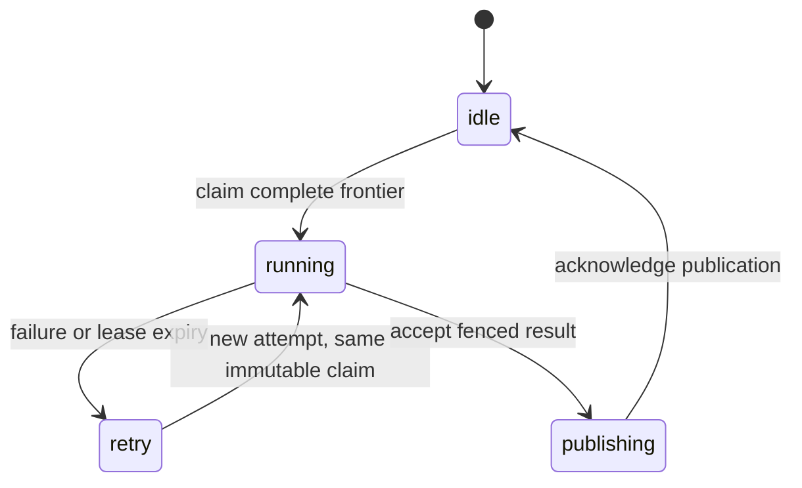

# Duckstream execution, recovery, and Conduit retirement

Duckstream should be Pronto's relational derivation engine: Feldera consumes
PostgreSQL CDC on a server; native DuckDB or DuckDB-Wasm evaluates the same
derivation over an identified snapshot elsewhere. Golaberto is the first
consumer of its expensive-computation boundary. Its ratings and simulations
do not define the engine's scheduling or join semantics.

The [[../../spikes/duckstream/docs/index|spikes]] are executable experiments,
not a production adapter. The current emitter writes SQL files and the checker
inspects their DuckDB AST. Neither starts Feldera, installs CDC connectors, nor
implements a reactive DuckDB runtime. The existing `hot`/`cold` schema remains
unchanged while these runtime questions are resolved.

The first implementation now uses compiled Cortex batch machines and Airlock
internal work for durable dispatch, retained query inputs, dependency scheduling
and atomic statistics publication
to the existing compute service. Its live contract is in
[[../pipelines-and-schedules#Computations|computations]]. Conduit/Redis remain;
Feldera execution/replay, per-group chances jobs and drain migration below are
still proposed. The implementation is not a completed retirement.

## Decision and migration scope

Replace every Pronto/Mecha application use of Conduit and retire Redis with its
last consumer. Duckstream owns relational derivation; Mecha machines and the
Graphile-backed Airlock infrastructure own durable work; PostgreSQL owns source
rows, work records and published results. Pure numerical work remains in the
existing compute workers. Feldera is recomputable derived state, with an explicit
recovery contract. DuckDB supplies snapshot execution on other targets.

The first delivery is Golaberto minibatching with the existing Conduit feed
still running. It must improve scheduling, input reuse and publication without
waiting for Feldera's compiler bridge or replay adapter. Retiring transport is a
later cutover, not a prerequisite for reducing repeated full computations.

This decision replaces the intended runtime architecture, not the current
[[../pipelines-and-schedules|pipeline contract]]. The implementation still uses
Conduit, Redis Streams and Redpanda Connect/Bloblang. Preserve their working
behavior until each replacement passes its acceptance cases.

### Responsibilities, rather than a service-for-service substitution

| Existing responsibility | Proposed owner | Trade-off |
| --- | --- | --- |
| Conduit snapshot/WAL capture and row envelopes | Feldera native PostgreSQL CDC for live relations; explicit replay/bootstrap adapter where required | Fewer live transport hops, but experimental connector recovery and cross-table progress need proof. |
| Redis Streams consumer groups, backlog and retries | Retained input/lifecycle/result streams, SQL-derived eligibility, Cortex claims and Airlock execution/publication | Source changes do not create PostgreSQL dirty rows or jobs. Durable admitted executions remain distinct from replay history. |
| Bloblang filtering, mapping, joins and recounts | Typed Duckstream SQL, plus bounded pure Jessie transformations where SQL does not fit | Shared server/browser semantics and incremental joins; compiler admission and type equivalence become platform obligations. |
| Bloblang HTTP/model/object-storage side effects | Mecha invokes Airlock effects with stable command identity | Durable outcomes and explicit reconciliation replace ad hoc retry chains; long jobs need asynchronous submission/completion. |
| Projection writes through many PostgREST calls | Internal transactional PostgreSQL publication adapter | Atomic visibility and fenced revisions; must preserve authorization, constraints, triggers and client confirmation semantics. |
| Timers, drains and computation invalidations | SQL feedback eligibility and explicit durable clock inputs where needed; existing dirty-key queues during migration | Golaberto starts when idle and coalesces while busy; temporal membership alone does not schedule work. |
| Trace markers, type normalization, dependency filters and feedback prevention | Compiler/adapters and batch provenance | These are migration requirements, not incidental behavior we may drop with the bus. |

Feldera can perform a pure single-event map or enrichment. Durable commands must
remain explicit immutable events/outbox rows: relational consolidation may omit
intermediate transitions, while a command consumer may owe every occurrence.
Coalesce invalidations of current state; never silently coalesce user commands.

Repository inventory anchors (paths are code evidence, not additional contracts):

- `apps/golaberto`: numeric computations, raw standings/game-card/player-stat/round
  pipelines and SQL drains; detailed first migration below.
- `apps/realworld`: favorite index/count/recount and tag recount. Preserve deletes,
  zero-count removal, type carriers and transaction-confirmed UI behavior.
- `guis/snapcards`: CDC plus text/image generation, object uploads and row updates;
  move effects to machines/Airlock, including retry/reconciliation and cleanup.
- `guis/iris`: CDC request dispatch to tracking and translation workflows; preserve
  every request and its durable outcome, not just the latest request-table state.
- `libraries/mecha/cluster.cue`, Pronto emission, local compose, Kubernetes and
  cloud overlays: remove generated Conduit/Redis dependencies, Dapr pubsub
  components, credentials, slots, health checks and tests only after migration.
  `apps/truco` also has a generated Conduit image include to audit; an include
  alone does not prove an active consumer. Primer and Plausible explicitly use
  tab-only execution; mentions in their design text are not running CDC services.
- `apps/calcom/oracle/compose.yaml` runs upstream software with its own Redis.
  This is a distinct application dependency: retiring platform Redis does not
  remove it. Inventory and replace that use or explicitly isolate the upstream
  oracle before claiming repository-wide Redis retirement.

Redis retirement requires checking all consumers, including caches, Dapr state,
locks, pubsub and test fixtures, rather than assuming all Redis usage is CDC.
Other transports such as the existing cloud Pub/Sub overlays also need consumer
migration; deleting a local Redis service does not migrate those deployments.
Dapr bindings used by Airlock are independent of Redis and may remain.

The [[2026-10-20-duckstream-backend-contract|backend contract decision]] refines
compatibility below: each environment holds the admitted published computation
contract, without reproducing another engine's scheduling or intermediate trace.

## A deliberately simple DuckDB adapter

The shared runtime contract is a versioned materialized result, not an exposed
incremental operator graph. Feldera maintains that result incrementally. The
DuckDB adapter recomputes the complete admitted relation from a consistent
snapshot and publishes the difference from the last committed result. Cortex
and sinks consume the same completed-update envelope: program version, run
identity, source provenance, declared logical time, result changes and completion.
A snapshot identity is provenance, not an invented common CDC frontier.

The fallback has four responsibilities: capture and retain immutable inputs,
evaluate generated SQL, compare the full result with the last published result,
and atomically publish changes with its durable outcome. One active run and one
coalesced successor bound scheduling state, not retained event backlog. A crash before publication retries retained
inputs; a committed outcome prevents repeat publication. Rebuilding from source
is legitimate when the query is reconstructible from that source. The generic
adapter is proposed; the existing compute coordinator provides its durable work
and internal-publication foundation.

DuckLake snapshot IDs are a candidate retained-input representation: DuckDB can
query prior captured versions without a custom history store. The current compute
workspace expires old snapshots, so this requires a changed retention lifecycle,
durable catalog/data storage and deployment-specific validation before replacing
retained query inputs. Snapshot history preserves captured states, not source
mutations that occurred and disappeared between captures; every-event semantics
still require CDC or immutable source events. See DuckLake's
[time travel](https://ducklake.select/docs/stable/duckdb/usage/time_travel) and
[snapshot expiration](https://ducklake.select/docs/stable/duckdb/maintenance/expire_snapshots)
contracts. Snapshot retention does not itself establish event-time completeness.

Reuse the existing CDC feed for this history path before replacing Conduit.
Ingest raw changes before computation invalidations are coalesced. Commit each
DuckLake ingestion batch with its source position and replay identity before
acknowledging transport delivery. A lost acknowledgment must replay idempotently;
source positions and coverage require a tested connector-specific mapping, not
an assumed wall-clock ordering. Verify transaction boundaries and cross-table
coverage before advertising a consistent source cut. Replacing CDC transport is
then independent of replacing the relational evaluator.

For current-state relations, apply each batch's changes to versioned DuckLake
tables. For every-occurrence semantics, also retain immutable CDC events with
stable identities: an insert followed by a delete within one ingestion commit
may disappear from the final table snapshot. Such commands/events must not be
recovered by pretending that a net table difference contains every occurrence.
This ingestion adapter, retained history and source-position protocol remain
proposed; the existing compute service still receives coalesced invalidations.

Do not implement affected-window tracking, incremental join arrangements,
per-operator checkpoints or delta propagation in the DuckDB fallback. HOP/TUMBLE
lower to ordinary SQL and all windows over retained inputs can be recomputed.
Optional app-specific dirty-group numerical jobs are a later performance choice,
not a prerequisite for engine compatibility or Conduit retirement. The cost is
full scans and result comparison on each refresh; deployments may choose slower
refreshes or reject a workload that exceeds their resource budget.

Equivalence means the same relation at a completed refresh over equivalent
inputs and logical time, not the same intermediate delivery timing. Keyed sinks
need stable declared keys; a relation without keys must preserve duplicate-row
multiplicities when computing its difference. Each backend must pass contract fixtures for updates, deletes, empty results,
joins, types and windows. Cross-engine comparisons are diagnostic evidence, not
a requirement to match internal execution or every permitted numerical outcome.

Publication completion and event-time finalization remain separate signals.
Neither a periodic refresh nor the latest observed timestamp proves an older
window final. A shared declared progress/lateness policy may establish that
frontier; otherwise expose revisable results without a finalization claim.
History-dependent queries require retained immutable events, not merely current
mutable source rows. Admit only semantics whose required inputs and progress
contract the selected adapter can supply; do not silently approximate them.

## One semantic frontend

Compile authored relations once through Feldera's SQL frontend. Keep the typed
Calcite relation before conversion to a DBSP circuit. Generate both the Feldera
program and a DuckDB evaluation artifact from that definition. Never ask an app
to author both SQL dialects.

The stock Calcite `RelToSqlConverter(DuckDBSqlDialect.DEFAULT)` is the first
bridge candidate. The compiler spike accesses Feldera's package-local `views`
map, so this is an internal compiler integration pinned to a release, not a
supported Feldera REST export. Its diagnostic JSON plan is evidence, not an
interchange ABI. Production needs an explicit upstream export/hook or a small,
versioned integration that fails on incompatible compiler versions.

The tested ordinary join/filter/aggregate executes unchanged in native DuckDB
1.4.3 and browser engine 1.5.4 with matching fixture values. Its aggregate type
does not match: Feldera declares `BIGINT`, DuckDB produces `HUGEINT`, and the
browser exposes Arrow Decimal128. Output schemas, overflow and serialization
must be part of compiler admission. This test does not establish general
equivalence or native/browser version parity.

The stock converter leaves `TUMBLE` and `HOP` inside `FROM TABLE(...)`, which
both tested DuckDB engines reject. A lowering pass must preserve
half-open boundaries, offsets, timestamp precision, null behavior, and overlapping
membership. It should transform typed relations and expressions, not rewrite SQL
strings. Unsupported functions or types fail the build. Window lowering and
arithmetic compatibility need differential tests against actual Feldera output.

Substrait is an alternative transport for the logical relation. It adds a
runtime extension and a function/operator mapping, and does not itself supply
streaming time, progress, or finalization semantics. It is not yet exercised by
these spikes. Prefer generated ordinary SQL if it covers the required relations
on both native DuckDB and DuckDB-Wasm.

## Time is part of the relation and its delivery contract

Keep three independent choices:

| Choice | Examples | Meaning |
| --- | --- | --- |
| Membership | ordinary relation, tumble, hop, interval join | Which records contribute to a result. |
| Delivery | changes, periodic snapshot, final window | When downstream consumers receive a usable revision. |
| Execution | incremental circuit, snapshot recomputation | How a deployment evaluates the relation. |

A five-second tumble groups records; a five-second hop over a minute describes
overlapping membership. Neither alone promises one job every five seconds.
Microbatches need a release condition, an input frontier, and an identity.
Feldera's `emit_final` is a candidate for event-time finalization, not a substitute
for a clock or an import-complete barrier. Its documentation marks it experimental.

The application must distinguish event time from ingestion or processing time.
Event-time finality depends on progress from inputs and a defensible lateness
bound. Idle input cannot be assumed to advance that bound. For processing-time
release, a machine deadline can request a batch over the latest complete
frontier. A clock tick cannot falsely assert that older events will never arrive.
An ordered heartbeat can carry a source's promised progress through the same
capture path; it needs a source contract for late writes and all relevant inputs
must reach the required boundary. An arbitrary heartbeat timestamp, CDC activity
on another table, or an idle partition does not establish event-time completeness.

Late corrections require a declared policy: revise an existing result, reopen
work under a new revision, or reject data outside an explicit contract. Never
silently attach a lateness bound to editable historical rows to save memory.
For Golaberto, match dates are business time; corrections are new invalidations
now. Imports can close an explicit generation instead of waiting for quiet.

Freshness is measured from source progress through publication. A five-second
release interval cannot guarantee five-second result freshness if computation
takes thirty seconds. Each publication should identify its input frontier and
completion time; pending work remains visible to the platform.

## CDC consistency precedes batching

Use Feldera's PostgreSQL CDC connector, not the one-shot PostgreSQL query
connector. Pin the engine image and its source migrations together. Bootstrap,
retractions, connector lag, and restart behavior are acceptance cases.

A completed PostgreSQL transaction is not automatically a common frontier across
independently consumed tables. A downstream job must not confuse a temporarily
mixed join with a complete input snapshot. A valid batch boundary requires
either a proven common frontier through every dependency or an immutable,
consistent source snapshot evaluated by DuckDB. A wall-clock timestamp, a row
count, or a marker observed on only one connector is insufficient.

Feldera checkpointing, source acknowledgement, and sink publication are separate
boundaries. The current official documentation assigns checkpoint recovery to
Enterprise and PostgreSQL CDC at-least-once recovery; the OSS prototype must not
claim that guarantee. A full rebuild is a distinct lifecycle operation, with a
new generation and complete source bootstrap, not a transparent restart path.

The OSS spike confirms this failure mode: after a forced stop/start without
storage, the circuit contains only newly arriving records while PostgreSQL
retains all originals. Pause/resume works. A production CDC deployment therefore
requires a verified checkpoint/recovery configuration or an explicit full
rebootstrap protocol. Simply restarting the process is incorrect.

Fresh-source initialization also exposed concurrent creation of the connector's
shared `etl` schema. Serializing connector initialization passes the isolated
test. Multiple managers need coordinated administrator bootstrap rather than
assuming that a per-pipeline concurrency limit serializes their migrations.

## Recovery analysis from the shared plan

The compiler should emit a versioned recovery manifest alongside DuckDB SQL:
input dependencies, partition keys, temporal predicates, join bounds, mutable
versus append-only semantics, clock/watermark assumptions, required baseline,
and whether historical outputs or only current materialized state must survive.
Bind it to the program, schema and compiler versions. An unproved operator or
opaque computation requires the complete declared input baseline; never guess a
finite horizon from its name or observed data. Feldera's existing bounded-state
warnings are useful diagnostics, not a recovery certificate.
[Time-series analysis](https://docs.feldera.com/sql/streaming/).

Propagate requirements backward through the typed plan and union them across
consumers. A filter inherits its consumer's requirements; bounded joins expand
requirements on both sides; an unrestricted dimension join requires its dimension
state even when the fact stream is windowed. Aggregation, recursion, ranking and
UDFs require proven rules or a full baseline. A constant-sized dimension is not
necessarily a recently-created dimension.

For aligned windows, suppose all windows ending through 12:00 are final and
have been durably accepted, with no holes:

| Query | Earliest event time needed for the next outstanding window |
| --- | --- |
| Five-minute TUMBLE | 12:00, for `[12:00, 12:05)` |
| Ten-minute HOP sliding every five minutes | 11:55, for `[11:55, 12:05)` |
| Window over a bounded join | Expand the above through each join's time predicates. |
| Window joining an unrestricted dimension | The fact horizon plus a complete appropriate dimension baseline. |
| Unrestricted stream join | Potentially the original baseline and every subsequent change. |

These examples assume append-only facts and enforceable finality. Arbitrary
historical corrections invalidate that finite-replay proof. A delivered
provisional result is not final; use a correction/revision contract or retain
history. Window offsets, time zones and nested windows are part of the analysis.

### From event time to a replay position

Maintain three distinct boundaries: captured input, engine-consumed input, and
durably accepted output. Track finalized output as a contiguous frontier per
query/partition, including empty windows; a maximum window end with missing
outputs is not a frontier. Acceptance means a PostgreSQL result commit or an
Airlock claim that contains enough immutable payload to finish without Feldera.
Merely enqueuing a pointer into a disposable circuit is insufficient.

The plan yields input requirements, not an LSN. A proposed capture/replay adapter
must retain transaction boundaries, source identity/epoch, schema versions,
before/after images as required, and conservative event-time provenance. Select
a transaction boundary before every required input and replay through catch-up.
Future-dated events may already have arrived before the last window closed;
late changes may arrive afterward. A watermark-to-LSN map alone misses the former.
Persist replay records and their index before acknowledging capture past them;
observe-only logging after Feldera has acknowledged PostgreSQL is not sufficient.
For an independent capture/archive path, prove its own snapshot handoff and
retention independently of Feldera's live cursor. Reuse one retained capture for
multiple consumers where possible rather than holding an unbounded WAL slot per
query. The replay archive is additional infrastructure even if stored in existing
PostgreSQL/object storage.

Segment min/max metadata may over-retain safely; indexing only new-row timestamps
cannot account for moved timestamps, deletes or preexisting dimension rows.

For mutable relations, supply a consistent baseline at the replay boundary and
apply later changes exactly once logically, deduplicating by source transaction
and record identity. A delete or update cannot reconstruct an absent earlier row.
For multiple independent sources retain a vector of positions; compare scalar
LSNs only within their source/epoch. Replay clock/progress events where they affect
results, without advancing watermarks ahead of historical data during recovery.

Replaying from database creation is valid only if capture and retention began
there and include all required history. Otherwise retain a consistent initial
snapshot with a gap-free CDC handoff. A stored LSN does not retain WAL, and a
replication slot is not an indefinitely rewindable archive.
[PostgreSQL logical decoding](https://www.postgresql.org/docs/current/logicaldecoding-explanation.html).

The native connector exposes neither a documented arbitrary `start_lsn` option
nor this query-dependent recovery manifest. Its replication state persists in
the source database. Do not assume renaming a pipeline resets it, or delete a
shared `etl` schema as a per-pipeline reset. Select and prove one supported
replay/bootstrap integration before admitting OSS continuous execution; direct
live CDC remains the goal, but external replay may need a connector extension
or a separate replay input. Record this as an unresolved adapter, not a delivered
capability. [CDC configuration](https://docs.feldera.com/connectors/sources/postgresql-cdc/).

### Recovery lifecycle and retention

Mecha fences the failed generation, keeps the last published results readable,
loads the required baseline/history, and catches up every dependency to a complete
frontier before enabling publication. Suppress bootstrap effects. Reconcile new
desired rows and deletions only within the reconstructed partitions and intervals;
preserve the accepted historical prefix that bounded replay deliberately omitted.
Whole-relation replacement requires a whole-relation reconstruction. Persist the
reconstruction scope with its generation so an empty result cannot erase unrelated
history. Stable
logical effect keys exclude rebuild generation; computation revisions include
program version, immutable inputs and seed. Fence worker attempts separately.

Only trim replay inputs once every dependent query's recovery requirement and
outstanding immutable job permits it. A slow consumer can pin retention; split
pipelines where that cost warrants it. New queries, wider windows and schema
changes require reanalysis and possibly a new baseline before activation. Missing
history fails admission/recovery loudly, or selects an explicitly configured full
source rebootstrap; it never silently resumes from the latest cursor.

Checkpoints remain a valid optimization: restore state and its matching cursor,
then replay the suffix. Replay avoids requiring Enterprise but adds storage,
capture integration and recovery time. A fresh source snapshot can reconstruct
current relations, but cannot reproduce lost historical commands or window
outputs. The deployment must declare which of these guarantees it supplies.

## Coordinate with Mecha machines

The machine spike and current implementation below keep invalidation counters in
the machine. The target [[2026-10-20-duckstream-backend-contract#Coordination as a feedback query|feedback
contract]] moves required/published coverage and eligibility into SQL while
retaining machine authority for claims, retries and publication.

Reuse [Mecha's bounded reducers](https://github.com/bonisoft3/mecha/blob/v0.20.6/docs/machines.md)
for control state. Feldera owns relational maintenance; workers execute pure
computations. A machine coordinates claims, retries, deadlines, and publication.
It does not contain joins, simulation loops, or SQL dialect translation.

The [[../../spikes/duckstream/machine/docs/index|batch protocol spike]] executes
the existing Mecha compiler and reducer runtime. One instance coordinates one
materialization or explicitly independent partition:

Invalidations monotonically advance `requested` in every state. A running
attempt holds `claimed`; successful publication advances `published`. New
invalidations never disappear when an older attempt completes. Artifact and
attempt identities prevent expired workers from publishing over accepted work.

The pure reducer is only one part of durability. Claim plus durable dispatch,
snapshot retention, conditional publication, and acknowledgment need transactional
adapters and crash tests. Use the existing Airlock/Graphile execution
infrastructure described below. `pg_notify` is a wakeup hint, never the durable
queue. Do not add another
workflow engine merely to coordinate Duckstream.

DuckDB is the relational stand-in, not a durable machine store. A browser,
Cloudflare, or native deployment needs an explicitly selected coordinator
adapter with its own durability and concurrency guarantees. A browser demo may
replay the pure machine while open; it cannot promise unattended work after
the tab closes.

## Airlock as durable execution and internal publication

The current implementation below combines numerical completion and final sink
publication. The target [[2026-10-20-duckstream-backend-contract#Evaluation and publication|backend
contract]] instead admits durable result candidates into an authoritative SQL
view, then materializes that view to PostgreSQL. Airlock remains the execution
foundation; it need not dispatch a second job for each relational sink update.

Reuse the [Airlock contract](https://github.com/bonisoft3/mecha/blob/v0.20.6/services/airlock/README.md):
the machine transition atomically claims a frozen input in the ledger and
enqueues Graphile work; retries preserve its logical key; recorded outcomes can
redeliver the machine transition after a crash. PostgreSQL is already its durable
queue. Do not add Redis or a second workflow engine for batch coordination.

Airlock names both reusable execution machinery and a specific external-effect
boundary. Its current handlers have only declared HTTP sinks, run in a confined
worker and time out after 60 seconds. Its external-origin admission does not
provide an internal PostgreSQL write path. Extend the infrastructure with explicit
internal task/publication adapters; do not grant effect scripts arbitrary SQL or
route database writes through an external HTTP binding to evade that boundary.

| Work | Execution and commit boundary |
| --- | --- |
| Short internal projection | A constrained SQL operation, dirty-key acknowledgment and completion commit in one PostgreSQL transaction. No external-effect reconciliation is necessary. |
| Long DuckDB/Wasm calculation | Claim immutable inputs, compute outside the database transaction, stage an immutable result, then use the internal publication transaction. No long-held SQL locks while computing. |
| External effect | Existing Airlock issue/reconcile/unknown contract; provider idempotency or reconciliation handles an ambiguous response. |

A publication transaction verifies the active claim, attempt fence and expected
published revision, validates staged rows, applies changed rows and scoped
deletions across all sinks, records the result receipt, advances the machine and
queues downstream invalidations. A retry after commit observes the receipt and
does not repeat publication. A crash before commit leaves the old visible result.
Large outputs can stage by generation and atomically switch a manifest only if
all readers and sync consumers honor that manifest; otherwise use transactional
set-based writes to the existing tables. Preserve RLS/tenant scope, constraints,
triggers and service-role semantics through a narrowly granted adapter, rather
than writing app data as the ledger owner by default.

Use one owner for dispatch retries: Graphile/Airlock. The batch reducer's attempt
fence protects publication, not a competing lease scheduler. Its spike lease is
experimental and must be reconciled with Airlock's process-liveness recovery.
For a remote numerical worker, submission returns a durable job identity quickly;
completion is a separate idempotent transition. Never keep a 60-second effect
handler waiting for an arbitrarily long simulation.

The output-to-ledger handoff must itself be durable and replayable. Feldera HTTP
egress is not a durable queue; a disconnect before a claim cannot be repaired by
Airlock deduplication. Choose a durable sink/acknowledgment integration or reconcile
materialized outputs from a retained generation before advancing acceptance.
[HTTP output contract](https://docs.feldera.com/connectors/sinks/http/).

## First delivery: Golaberto minibatches

### Baseline before minibatch adoption

The baseline code paths are `apps/golaberto/{program.cue,drains.cue,cdc.cue,computations/}`
and `libraries/mecha/services/compute/{main.ts,events.yaml}`. The pre-migration compute bus
already unions invalidations over one second, reads up to 1,000 stream entries
at a time, caps a batch at 10,000 messages and allows one HTTP request in flight.
Compute serializes work in one process, copies declared inputs into DuckLake,
compares inputs with its prior result, and recomputes on startup or invalidation.
It discards older lake snapshots. The former publication path validated in a rolled-back SQL transaction, then
wrote through separate CRUD requests, allowing mixed sinks after a partial
failure. Its retries reread inputs. The first implementation replaces those
boundaries with retained inputs and transactional publication; the source lake
remains disposable.

Several SQL drains already operate on dirty-key queues. Their initial batch
limits are roster 50, rating charts 10, odds charts 5 and team profiles 50; team
enrichment and profiles share an advisory lock. Other drains still refresh whole
relations. UTC and São Paulo midnight schedules emit `day_tick` for date-dependent
results. Thus the first change is durable, scoped batching and atomic publication,
not claiming to introduce the repository's first debounce.

| Workload | Proposed minibatch boundary |
| --- | --- |
| Ratings: TeamRating, PlayerRating, RatingEval | One coalesced archive revision initially. The iterative fit can couple teams across years; no arbitrary per-team partitioning or delta algorithm is claimed. |
| Chances: TeamChance, ZoneChance, PositionChance, GameImportance | Dirty groups, after required standings and ratings revisions are ready. Reuse unchanged group input hashes and deterministic seeds. |
| Standings, rounds, player stats, game cards | Dirty groups/phases/player-championship keys/games, with old and new keys invalidated for moves and deletes. Replace recounts with Duckstream relations as equivalence is proved. |
| Team enrichment and profiles | Retain existing durable dirty-key semantics and locking; one scheduled drain per scope, bounded chunks until empty. |
| Team directory, matches games, recent championships | Move whole-refresh drains to dependency-derived key sets where proven; coalesce one full refresh where partition independence is unproved. |
| Midnight/date-dependent changes | Durable logical date invalidation, folded into the same queues; clock changes only invalidate dependent relations. |

Ratings currently derive their clock from the latest played game, with seven-year
historic fits and a shorter player-rating horizon. Preserve those semantics and
historical rating cutoffs used by chances. Minibatching reduces the number of
full fits; it does not make the numerical solver incremental. Its opaque Wasm
stage declares inputs and partition assumptions rather than inheriting a finite
recovery horizon merely because surrounding SQL uses windows.

### Batch protocol

The [[2026-10-20-duckstream-backend-contract#Coordination as a feedback query|feedback
query contract]] replaces the earlier proposal to persist source invalidations
and release them with Cortex deadlines. The retained stream holds pending input;
SQL derives dirty and runnable work from applied changes, lifecycle events and
published coverage. Cortex owns durable admission/execution and Airlock owns
atomic publication. Existing dirty-key queues describe migration state, not the
target protocol.

Golaberto starts immediately when idle and takes one coalesced successor after a
running fit completes. Each claim fixes a retained, consistent snapshot and its
program/epoch identity. Publishing that claim covers only its input; newer
requirements remain pending. WASM fitting remains unchanged. Dependency admission
and source capture still need production integration beyond the independent-scope
feedback spike.

### Dependency and output ownership

A ratings publication wakes chances once per committed revision, not once per
rating row. A chances claim must pin a coherent combination of source, standings
and rating revisions. Track the source coverage of those upstream results; merely
checking that standings contain the expected team count is insufficient. While
old pipelines remain, either verify their coverage explicitly or compute the
required relational inputs from the same snapshot. Do not mix new game scores
with old standings because both tables were readable.

Groups can share games: the current `finish` merges non-null home/away importance
contributions from different groups. Preserve that reduction explicitly, including
removal of a group's old contribution. Before parallel chances publication, assign
one reducer/owner to each GameImportance row or stage group contributions and
reduce them transactionally;
per-group replacement must not delete another group's output. Changes that move
membership dirty both old and new groups, including empty/deleted groups. Partition
replacement deletes only rows in the claimed scope. No per-group worker may use
the current whole-sink deletion contract unchanged.

Capture odds history from the accepted complete publication, with its recorded
logical capture time and revision, in the same transaction or through an
idempotent durable follow-up. Then dirty the chart groups once. Preserve the
current daily history policy; retries and rebuilds must not invent extra history
or change a capture's day by consulting the retry's wall clock.

Preserve calendar-driven behavior. Replace cron-triggered full recomputations
with durable clock/date invalidations and catch-up on resume, retaining UTC and
São Paulo semantics. A current-state projection may collapse missed days to the
latest date; an explicitly promised daily historical sample must retain each due
date. TUMBLE/HOP apply when membership is time-windowed; they are not required to
batch edits to a lifetime football archive.

### Staged rollout

1. Measure the existing coalesced path; add durable claims, retained snapshots and
   transactional publication for Golaberto. Keep Conduit/Redis/Connect as ingress.
2. Migrate drains and raw projections behind the common result-publication
   contract; begin with complete snapshot recomputation in DuckDB. Dirty-group
   chances jobs are optional later optimization. Compare against existing recomputations
   over identical inputs/seeds, including moves, deletes and historical edits.
3. Add the typed compiler lowering, Feldera live evaluation and recovery manifest.
   Shadow outputs without effects. Prove bootstrap, cross-table progress and
   replay before giving Feldera publication authority.
4. Cut over one sink family at a time under a writer fence. Stop/drain the old
   writer before enabling the new one; never let both reconcile the same tables.
   Keep rollback artifacts and the old path available temporarily. A rollback
   also fences the new writer and reconciles current state before publication.
5. Migrate RealWorld, Snapcards, Iris and every remaining consumer; regenerate
   deployment closures. Remove Conduit, Connect/Bloblang pipelines with no remaining
   owner, and Redis only after the last dependency is gone. Retire slots after the
   rollback horizon, confirming no consumer still needs their history.

## Performance and operational trade-offs

The architecture is plausible for these workloads, but no throughput or recovery
benchmark yet proves it. Existing spikes prove selected semantics, not capacity.
The largest immediate gains should come from fewer repeated full fits, fewer
snapshot copies and fewer output writes. Scoped chances jobs are optional. Feldera cannot
accelerate an opaque full Wasm fit by maintaining its SQL inputs incrementally.

| Cost | Expected benefit and remaining risk |
| --- | --- |
| Per-event delivery | Replace repeated recounts and HTTP fanout with batched invalidations and set-based publication. Avoid one Graphile job/ledger row per CDC row. |
| Relational maintenance | Incremental joins avoid repeated scans when changes are small. High fanout joins and broad dimension edits can still invalidate most outputs. |
| HOP | Explicit overlapping windows support temporal policy; width/slide can multiply memberships and output volume. A short slide is not free freshness. |
| Snapshot work | Share immutable inputs across dependent jobs and reuse content hashes. Hashing and copying the whole archive each second can cost more than the avoided computation. |
| Numerical work | Bound parallelism by measured peak memory and CPU; coalescing does not shorten one fit. Do not overlap global fits without proving independence. |
| PostgreSQL | Queue and result commits simplify consistency but add WAL, indexes, contention and vacuum pressure. Bulk stage results and publish only changed rows; keep large artifacts outside job payloads. |
| Recovery | Bounded replay can be cheap; full history replay or fresh bootstrap can dominate startup. Archive retention, catch-up headroom and recovery time are deployment budgets. |

Measure freshness as capture lag + coalescing wait + queue wait + snapshot time +
compute time + publication time. If a serial fit takes 30 seconds, a one-second
release timer cannot promise one-second freshness. Under sustained invalidation,
keep one pending successor; expose result age and backlog rather than accepting
unbounded jobs. For independent queued batches, required CPU service demand must
stay below available worker capacity with headroom; validate p95/p99 and bursts,
not just average throughput. Budget memory for Feldera state, DuckDB spill/cache,
Wasm jobs and PostgreSQL together. Existing target measurements in
[[../release-targets|release targets]] already rule out general numerical work
inside a small Worker isolate; they are not benchmarks for this proposed runtime.

Before cutover, compare the current one-second coalesced baseline against the new
path on a fixed hardware/dataset pair: single edits, 200-row bursts, large imports,
historical corrections, dimension changes, deletes, midnight with idle CDC,
sustained writes and forced crashes during compute/publication. Record work
started/completed, snapshot bytes, rows written, CPU, peak RSS/spill, PostgreSQL
lock/WAL load, p50/p95/p99 publication age, retained history and recovery duration.
Require exact relational parity and the existing numerical oracle tolerances,
no missing invalidations/commands, bounded pending work, no regression in the
agreed interactive freshness budget, and demonstrably less duplicate expensive
work. Set numeric SLOs from this baseline before production admission; no speedup
factor is asserted by this decision.

## Deployment choices

These are proposed Duckstream adapters. Existing release support is described in
[[../release-targets|release targets]]; shipping a target today does not imply
that it runs Duckstream.

| Target | Relational execution | Coordination and persistence | Current boundary |
| --- | --- | --- | --- |
| Pronto `pages`, including static hosting on Cloudflare Pages | DuckDB-Wasm in a browser worker | Pure reducer while the page lives; explicitly persisted snapshots for local resume | Pronto's `pages` publisher is GitHub Pages. No unattended work or server CDC in a static page. |
| Cloudflare Worker / Durable Object | Prefer native DuckDB in a Container for substantial workloads | DO holds authority and batch ledger; durable input/result artifacts outside the container; generation-checked application | The built edge target uses PGlite; the derivation worker, durable dispatch and machine adapter are proposed. |
| Compose / server | Feldera with PostgreSQL CDC; native DuckDB for batch evaluation and comparison | Mecha/PostgreSQL machines; explicit checkpoint and sink durability | The spike runs here. Production wiring is absent. |
| Pronto `docker` appliance | Add Feldera explicitly or select snapshot execution | Appliance machine adapter plus durable artifacts | Existing appliance closure is not the complete Compose service set. |
| GCP | Prefer Feldera on GKE for continuous operation; native DuckDB in batch workers | PostgreSQL/Mecha authority, persistent pipeline storage, versioned output artifacts | GCP release emission is not built. GKE suitability is an architectural inference, not a deployed proof. |

Cloudflare Workers have a 128 MB isolate memory limit and lack the browser Web
Worker API. Pronto's existing measurements in [[../release-targets|release
targets]] put representative chances and ratings computations beyond that
budget. DuckDB-Wasm inside the database DO therefore cannot be the general
stand-in; a tiny bounded workload would need its own workerd test.
[Workers limits](https://developers.cloudflare.com/workers/platform/limits/),
[Wasm execution](https://developers.cloudflare.com/workers/runtime-apis/webassembly/).

Cloudflare Containers can run native processes, but their writable disk is
ephemeral by default. The machine must retain enough input and identity to
recreate a computation and publish its result conditionally. Container snapshots
are not a replacement for that protocol.
[Container storage](https://developers.cloudflare.com/containers/faq/).

For GCP, Feldera's documented Enterprise architecture uses Kubernetes pipeline
pods with persistent storage. Cloud Run worker pools are another deployment
spike, not a proven substitute: continuous processes, restart handling and
checkpoint storage must be validated. Cloud SQL's `cloudsqlsuperuser` supports
event triggers, so there is no basis to reject it solely because Feldera installs
one. Test the pinned connector's bootstrap migrations and runtime grants against
Cloud SQL before committing to this topology.
[Feldera architecture](https://docs.feldera.com/architecture/enterprise/),
[Cloud Run worker pools](https://docs.cloud.google.com/run/docs/deploy-worker-pools),
[Cloud SQL roles](https://docs.cloud.google.com/sql/docs/postgres/users).

The deployment selector should state supported execution, temporal delivery,
recovery, and resource bounds. A DuckDB snapshot mode is a legitimate deployment
choice when those guarantees satisfy the program; it must not silently replace
an incremental/finality contract the target cannot provide.

## What must be proved before production

1. Supported typed relations compile to both engines and agree after inserts,
   updates, deletes and window-boundary cases, including browser execution.
2. The CDC adapter identifies a complete cross-table frontier, or a batch captures
   a consistent immutable snapshot by another explicit mechanism.
3. Restart cannot silently retain a source cursor while losing required relation
   state. Edition and connector recovery guarantees are enforced at deployment.
4. Mecha's durable adapter survives crashes between claim, dispatch, completion,
   publication and acknowledgment; stale workers cannot move the public manifest.
5. Bounded recovery matches uninterrupted execution for TUMBLE/HOP, including
   overlap, empty windows, future-dated early arrivals, late corrections, mutable
   dimensions, consumer holes and multiple input frontiers. Accepted historical
   outputs survive bounded replay, while obsolete rows within the reconstructed
   scope are deleted. Unproved cases use the declared full baseline and missing
   history fails explicitly.
6. Golaberto matches its full-recompute oracle across bursts, in-flight edits,
   dependency lag, midnight and crashes. Partition deletion and shared-output
   ownership are tested; retries do not duplicate odds history.
7. Every old consumer has a replacement and a single-writer cutover/rollback gate;
   generated deployments start with no Conduit or Redis once retirement is declared.
8. Each deployment either supplies its declared latency/freshness/durability
   contract or fails release admission. Snapshot evaluation is an explicit mode.

## Sources

- [Feldera PostgreSQL CDC](https://docs.feldera.com/connectors/sources/postgresql-cdc/).
- [Feldera checkpoint recovery](https://docs.feldera.com/pipelines/fault-tolerance/).
- [Feldera time series and final output](https://docs.feldera.com/tutorials/time-series/).
- [Calcite relational-to-SQL converter](https://calcite.apache.org/javadocAggregate/org/apache/calcite/rel/rel2sql/RelToSqlConverter.html).
- [Calcite DuckDB dialect](https://calcite.apache.org/javadocAggregate/org/apache/calcite/sql/dialect/DuckDBSqlDialect.html).
- [DuckDB Substrait extension](https://github.com/substrait-io/duckdb-substrait-extension).
